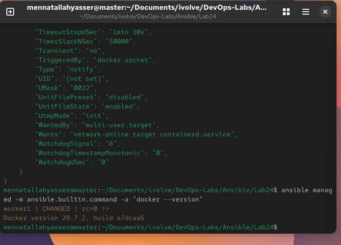

# Lab 24: Initial Ansible Configuration and Ad-Hoc Execution

`master` (192.168.111.128) is the control node and `worker1` (192.168.111.129) is the managed node.

## 1. Install Ansible on the control node

The VM is not registered with Red Hat, so `dnf install ansible-core` has no repo. `ansible-core` is installed with pip into a virtual environment instead, and its commands are linked into `~/.local/bin`:

```bash
python3 -m venv ~/ansible-venv
~/ansible-venv/bin/pip install ansible-core
for b in ansible ansible-playbook ansible-inventory ansible-config ansible-doc ansible-galaxy; do
  ln -sf ~/ansible-venv/bin/$b ~/.local/bin/$b
done
ansible --version
```

```
ansible [core 2.21.6]
```

## 2. Configure Ansible

[`ansible.cfg`](ansible.cfg) in this folder is picked up when Ansible runs from here:

```ini
[defaults]
inventory = ./inventory
remote_user = mennatallahyasser
private_key_file = ~/.ssh/id_ed25519
host_key_checking = False
interpreter_python = /usr/bin/python3.12

[privilege_escalation]
become_method = sudo
become_user = root
```

## 3. SSH key

Generate a key on the control node, then copy the public key to the managed node:

```bash
ssh-keygen -t ed25519
ssh-copy-id mennatallahyasser@192.168.111.129
ssh mennatallahyasser@192.168.111.129 hostname     # no password prompt
```

## 4. Inventory

[`inventory`](inventory):

```ini
[managed]
worker1 ansible_host=192.168.111.129
```

```bash
ansible all -m ansible.builtin.ping
```

```
worker1 | SUCCESS => {
    "changed": false,
    "ping": "pong"
}
```

## 5. Ad-hoc commands to install Docker

`-b` runs the module as root and `-K` asks for the sudo password. The `dnf` module only enables Docker's repo, to keep repo metadata off worker1's nearly full disk:

```bash
ansible managed -b -K -m ansible.builtin.dnf -a "name=docker-ce,docker-ce-cli,containerd.io state=present disablerepo=* enablerepo=docker-ce-stable"
ansible managed -b -K -m ansible.builtin.service -a "name=docker state=started enabled=true"
ansible managed -m ansible.builtin.command -a "docker --version"
```

Docker was already on worker1 from the Kubernetes labs, so the `dnf` module reports no change: Ansible only changes what doesn't already match the requested state.


