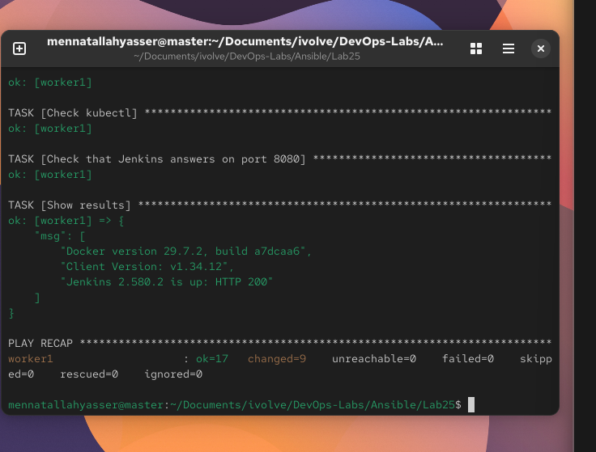

# Lab 25: Writing and Running an Ansible Playbook

`master` (192.168.111.128) is the control node and `worker1` (192.168.111.129) is the managed node. [`ansible.cfg`](ansible.cfg) and [`inventory`](inventory) are the same as in [Lab 24](../Lab24).

A playbook lists the tasks once, in a file, so the same setup can be run again on any host. [`playbook.yml`](playbook.yml) installs Docker, kubectl and Jenkins on worker1.

## 1. Docker

- Add Docker's repo with `yum_repository`
- Install `docker-ce`, `docker-ce-cli` and `containerd.io` with `dnf`
- Start and enable the `docker` service

## 2. kubectl

- Add the Kubernetes `v1.34` repo. Its `exclude` line stops normal updates from changing the Kubernetes packages.
- Install only `kubectl`. `disable_excludes: all` allows it for this one install.

## 3. Jenkins

The VM is not registered with Red Hat, so Java comes from the RHEL DVD (BaseOS and AppStream), which must be mounted on worker1.

- Add the DVD repos and the Jenkins repo
- Install `java-21-openjdk-headless` and `fontconfig`, then `jenkins`
- worker1 has little free RAM, so a systemd override limits the Java heap to 256 MB and gives Jenkins up to 10 minutes to start:

```ini
[Service]
Environment="JAVA_OPTS=-Djava.awt.headless=true -Xmx256m"
TimeoutStartSec=600
```

- Reload systemd, then start and enable `jenkins`

Each `dnf` task enables only the repo it needs (`disablerepo: "*"`), to keep repo metadata off worker1's nearly full disk.

## 4. Verify

The last tasks run `docker --version` and `kubectl version --client`, then wait for Jenkins to answer `http://localhost:8080/login` with HTTP 200 (up to 30 tries, 10 seconds apart).

## 5. Run the playbook

```bash
ansible-playbook playbook.yml --ask-become-pass
```

```
"Docker version 29.7.2, build a7dcaa6",
"Client Version: v1.34.12",
"Jenkins 2.580.2 is up: HTTP 200"

worker1 : ok=17  changed=9  unreachable=0  failed=0
```


