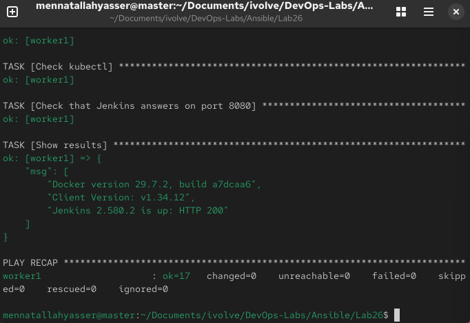

# Lab 26: Structured Configuration Management with Ansible Roles

`master` (192.168.111.128) is the control node and `worker1` (192.168.111.129) is the managed node. [`ansible.cfg`](ansible.cfg) and [`inventory`](inventory) are the same as in [Lab 24](../Lab24).

The single playbook from [Lab 25](../Lab25) is split into three roles: `docker`, `kubectl` and `jenkins`. Each role installs one tool and can be reused in other playbooks.

## 1. Role layout

```bash
mkdir -p roles/{docker,kubectl,jenkins}/{tasks,defaults}
```

```
Lab26/
├── ansible.cfg
├── inventory
├── playbook.yml
└── roles/
    ├── docker/
    │   └── tasks/main.yml
    ├── kubectl/
    │   ├── defaults/main.yml
    │   └── tasks/main.yml
    └── jenkins/
        ├── defaults/main.yml
        └── tasks/main.yml
```

- `tasks/main.yml` lists the role's tasks. It has no `hosts:` or `become:`, because the playbook decides where and how the role runs.
- `defaults/main.yml` holds the role's variables. They are default values that a playbook can override.

## 2. The roles

| Role | Tasks | Defaults |
|---|---|---|
| [`docker`](roles/docker/tasks/main.yml) | Add Docker repo, install `docker-ce`, `docker-ce-cli` and `containerd.io`, start and enable `docker` | none |
| [`kubectl`](roles/kubectl/tasks/main.yml) | Add Kubernetes repo, install `kubectl` | [`kube_version: v1.34`](roles/kubectl/defaults/main.yml) |
| [`jenkins`](roles/jenkins/tasks/main.yml) | Add RHEL DVD and Jenkins repos, install Java 21 and Jenkins, limit the Java heap to 256 MB, start and enable `jenkins` | [`rhel_dvd`, `redhat_key`](roles/jenkins/defaults/main.yml) |

## 3. The playbook

[`playbook.yml`](playbook.yml) runs the roles in order, then checks the result in `post_tasks`, which run after all roles have finished:

```yaml
- name: Install Docker, kubectl and Jenkins using roles
  hosts: managed
  become: true

  roles:
    - docker
    - kubectl
    - jenkins

  post_tasks:
    - name: Check Docker
    - name: Check kubectl
    - name: Check that Jenkins answers on port 8080
    - name: Show results
```

Ansible finds the roles in the `roles/` folder next to the playbook.

## 4. Run the playbook

```bash
ansible-playbook playbook.yml --syntax-check
ansible-playbook playbook.yml --ask-become-pass
```

Each task is shown with its role name, for example `TASK [docker : Install Docker]`.

```
"Docker version 29.7.2, build a7dcaa6",
"Client Version: v1.34.12",
"Jenkins 2.580.2 is up: HTTP 200"

worker1 : ok=17  changed=0  unreachable=0  failed=0
```

`changed=0` because Lab 25 had already installed everything on worker1. The roles found every task already in the requested state, so nothing was changed. This is idempotence: the same playbook can be run again safely.


