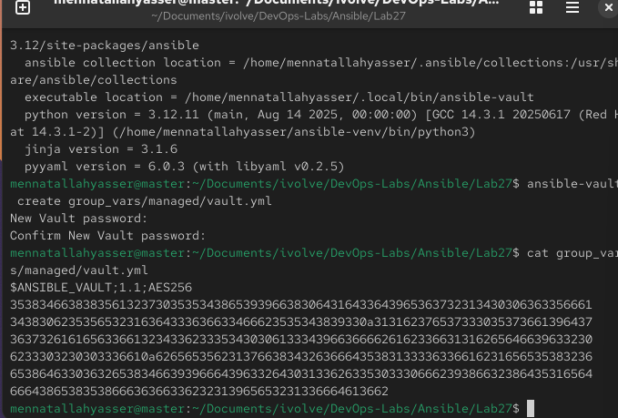
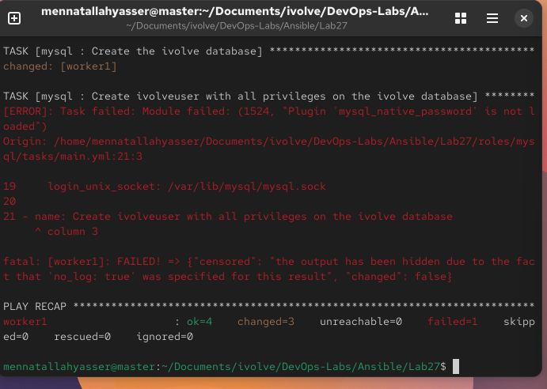
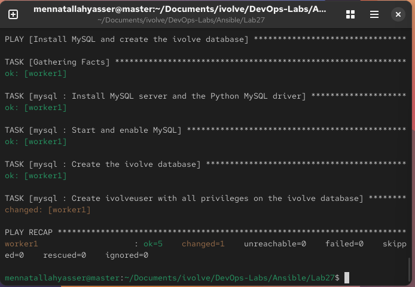
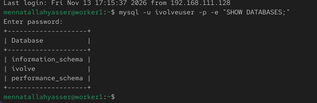

# Lab 27: Securing Sensitive Data with Ansible Vault

`master` (192.168.111.128) is the control node and `worker1` (192.168.111.129) is the managed node. [`ansible.cfg`](ansible.cfg) and [`inventory`](inventory) are the same as in [Lab 24](../Lab24).

A `mysql` role installs MySQL on worker1, creates the `ivolve` database, and creates `ivolveuser` with all privileges on it. The user's password is stored encrypted with Ansible Vault, so it can be pushed to GitHub without being readable.

## 1. Layout

```bash
mkdir -p roles/mysql/{tasks,defaults} group_vars/managed
```

```
Lab27/
├── ansible.cfg
├── inventory
├── playbook.yml
├── group_vars/
│   └── managed/
│       └── vault.yml          # encrypted
└── roles/
    └── mysql/
        ├── defaults/main.yml
        └── tasks/main.yml
```

Files in `group_vars/managed/` are loaded automatically for every host in the `[managed]` group.

## 2. Encrypt the password with Ansible Vault

`ansible-vault` was not linked in Lab 24, so link it first:

```bash
ln -sf ~/ansible-venv/bin/ansible-vault ~/.local/bin/ansible-vault
```

Create the vault file. It asks for a new vault password, then opens an editor:

```bash
ansible-vault create group_vars/managed/vault.yml
```

```yaml
vault_mysql_password: <password>
```

On disk the file is encrypted:

```bash
cat group_vars/managed/vault.yml        # $ANSIBLE_VAULT;1.1;AES256 ...
ansible-vault view group_vars/managed/vault.yml   # asks for the vault password, shows the content
```



## 3. The MySQL collection

`ansible-core` has no modules for MySQL databases and users. They come from a collection:

```bash
ansible-galaxy collection install community.mysql
```

This also installs `ansible.mysql`. The `community.mysql` modules are deprecated and will be removed in `community.mysql` 6.0.0, so the role uses `ansible.mysql.mysql_db` and `ansible.mysql.mysql_user`.

## 4. The mysql role

[`roles/mysql/defaults/main.yml`](roles/mysql/defaults/main.yml):

```yaml
mysql_db_name: ivolve
mysql_user: ivolveuser
mysql_password: "{{ vault_mysql_password }}"
```

The role only points to the vault variable. The real password is filled in from the vault when the playbook runs.

[`roles/mysql/tasks/main.yml`](roles/mysql/tasks/main.yml):

1. Install `mysql8.4-server` and `python3-PyMySQL` (used by the MySQL modules) from the RHEL DVD repos added in Lab 25
2. Start and enable `mysqld`
3. Create the `ivolve` database
4. Create `ivolveuser@localhost` with `ivolve.*:ALL`

The modules log in as MySQL `root` through the local socket (`/var/lib/mysql/mysql.sock`), which needs no password on a fresh install. The user task has `no_log: true`, so the password is never printed.

## 5. The playbook

[`playbook.yml`](playbook.yml):

```yaml
- name: Install MySQL and create the ivolve database
  hosts: managed
  become: true

  roles:
    - mysql
```

```bash
ansible-playbook playbook.yml --syntax-check --ask-vault-pass
ansible-playbook playbook.yml --ask-become-pass --ask-vault-pass
```

### Problem: `mysql_native_password` is not loaded

The first run installed MySQL and created the database, but creating the user failed:

```
Module failed: (1524, "Plugin 'mysql_native_password' is not loaded")
```



Given only `password:`, the module creates the user with the old `mysql_native_password` plugin, which MySQL 8.4 turns off by default. The fix is to use MySQL's default plugin:

```yaml
- name: Create ivolveuser with all privileges on the ivolve database
  ansible.mysql.mysql_user:
    name: "{{ mysql_user }}"
    plugin: caching_sha2_password
    plugin_auth_string: "{{ mysql_password }}"
    host: localhost
    priv: "{{ mysql_db_name }}.*:ALL"
    state: present
    login_unix_socket: /var/lib/mysql/mysql.sock
  no_log: true
```

The second run created the user:

```
worker1 : ok=5  changed=1  unreachable=0  failed=0
```



With `plugin_auth_string`, the module cannot compare the stored password with the requested one, so this task reports `changed` on every run.

## 6. Validate on worker1

```bash
ssh mennatallahyasser@192.168.111.129
mysql -u ivolveuser -p -e "SHOW DATABASES;"
```

```
+--------------------+
| Database           |
+--------------------+
| information_schema |
| ivolve             |
| performance_schema |
+--------------------+
```

`ivolveuser` logs in with the password from the vault and only sees `ivolve` plus MySQL's own system databases.


