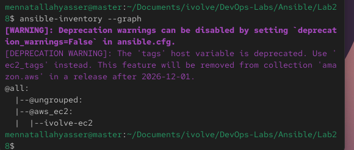
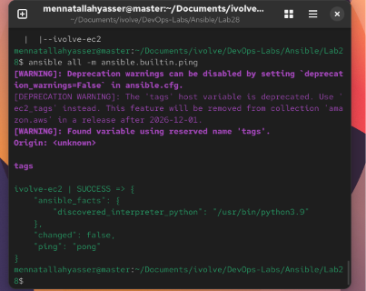
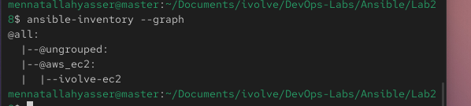
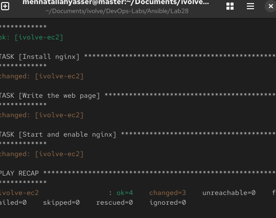
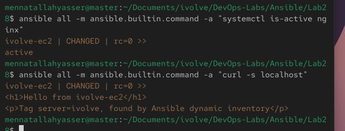

# Lab 28: Automated Host Discovery with Ansible Dynamic Inventory

`master` is the control node. Instead of a hand-written inventory with fixed IPs, Ansible asks AWS which EC2 instances are running with the tag `server=ivolve`, and manages whatever it finds.

## 1. Install the AWS tools on master

`boto3` is the Python library the AWS plugin uses, `awscli` provides the `aws` command, and the `amazon.aws` collection contains the `aws_ec2` inventory plugin:

```bash
~/ansible-venv/bin/pip install boto3 awscli
ln -sf ~/ansible-venv/bin/aws ~/.local/bin/aws
ansible-galaxy collection install amazon.aws
aws --version && ansible-galaxy collection list | grep amazon
```

```
aws-cli/1.46.3 Python/3.12.11 ...
amazon.aws  12.1.0
```

## 2. AWS credentials

An IAM user `ansible` with the `AmazonEC2FullAccess` policy is used instead of the root user. Its access key is saved on master:

```bash
aws configure          # access key, secret key, region us-east-1, output json
aws sts get-caller-identity   # "Arn": "arn:aws:iam::<account>:user/ansible"
```

## 3. SSH key

Master's existing public key is imported into AWS, so Ansible logs in to the instance with the same key it uses for worker1:

```bash
aws ec2 import-key-pair --key-name master-key --public-key-material fileb://~/.ssh/id_ed25519.pub
aws ec2 describe-key-pairs --query "KeyPairs[].KeyName"
```

## 4. Create the EC2 instance

Launched from the EC2 console in `us-east-1`:

| Setting | Value |
|---|---|
| Tags | `Name=ivolve-ec2`, `server=ivolve` |
| AMI | Amazon Linux 2023 |
| Instance type | `t3.micro` (Free Tier) |
| Key pair | `master-key` |
| Security group | SSH (22) from my IP |

## 5. Dynamic inventory

[`inventory.aws_ec2.yml`](inventory.aws_ec2.yml) (the file name must end in `aws_ec2.yml`):

```yaml
plugin: amazon.aws.aws_ec2
regions:
  - us-east-1
filters:
  tag:server: ivolve
  instance-state-name: running
hostnames:
  - tag:Name
compose:
  ansible_host: public_ip_address
use_deprecated_tags: false
```

- `filters` keeps only running instances tagged `server=ivolve`
- `hostnames` names each host after its `Name` tag
- `compose` connects to the instance's public IP
- `use_deprecated_tags: false` drops the old `tags` host variable (tags are in `ec2_tags`), which removes two warnings

[`ansible.cfg`](ansible.cfg):

```ini
[defaults]
inventory = ./inventory.aws_ec2.yml
remote_user = ec2-user
private_key_file = ~/.ssh/id_ed25519
host_key_checking = False
interpreter_python = auto_silent
```

`ec2-user` is the default user on Amazon Linux.

## 6. List the target hosts

```bash
ansible-inventory --graph
ansible-inventory --host ivolve-ec2
ansible all -m ansible.builtin.ping
```

Before `use_deprecated_tags: false` was added, the plugin warned about the deprecated `tags` variable:





After:

```
@all:
  |--@ungrouped:
  |--@aws_ec2:
  |  |--ivolve-ec2
```



No IP or host name is written in any file. Both come from AWS.

## 7. Run a playbook on the EC2 instance

[`playbook.yml`](playbook.yml) targets the `aws_ec2` group created by the plugin. It installs nginx, writes a page that uses the instance's AWS tags, and starts nginx:

```yaml
- name: Write the web page
  ansible.builtin.copy:
    dest: /usr/share/nginx/html/index.html
    content: |
      <h1>Hello from {{ ec2_tags.Name }}</h1>
      <p>Tag server={{ ec2_tags.server }}, found by Ansible dynamic inventory</p>
```

```bash
ansible-playbook playbook.yml
```

`ec2-user` has passwordless sudo, so no `--ask-become-pass` is needed.

```
ivolve-ec2 : ok=4  changed=3  unreachable=0  failed=0
```



## 8. Verify on the EC2 instance

```bash
ansible all -m ansible.builtin.command -a "systemctl is-active nginx"
ansible all -m ansible.builtin.command -a "curl -s localhost"
```

```
active

<h1>Hello from ivolve-ec2</h1>
<p>Tag server=ivolve, found by Ansible dynamic inventory</p>
```



## 9. Clean up

Terminate the instance so it does not keep running:

```bash
aws ec2 terminate-instances --instance-ids <instance-id>
```

After that, `ansible-inventory --graph` shows no hosts, because the inventory only lists running instances.
