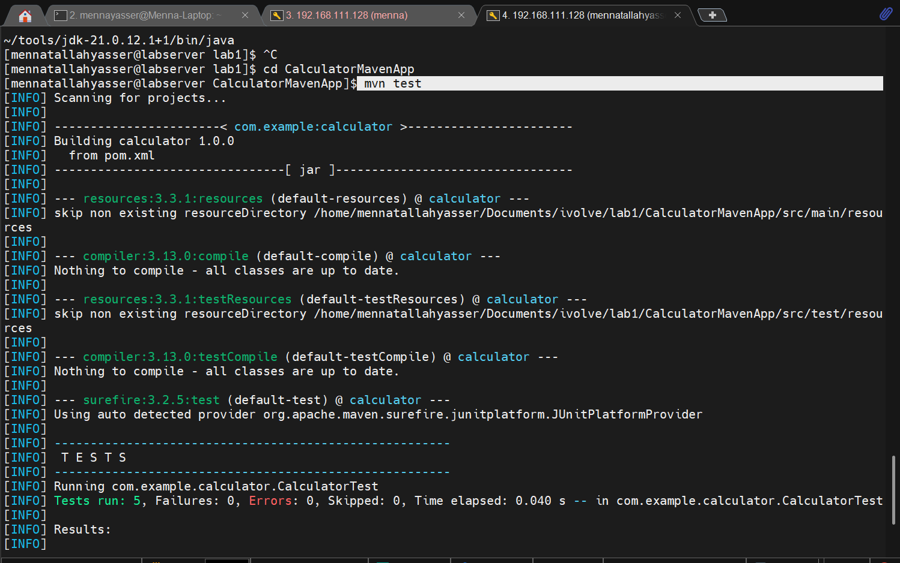
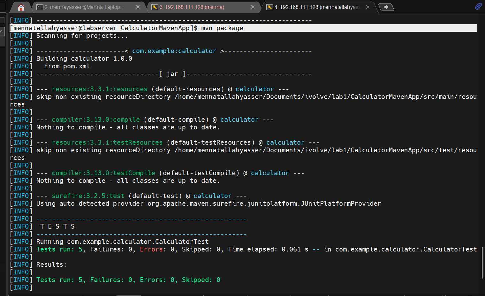
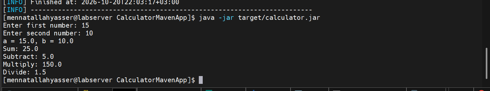

# Lab 1: Building and Packaging Java Application with Maven

## 1. Install Java and Maven

```bash
java -version
mvn -version
```

## 2. Clone source code

```bash
git clone https://github.com/Ibrahim-Adel15/CalculatorMavenApp.git
cd CalculatorMavenApp
```

## 3. Run unit test

```bash
mvn test
```



## 4. Build app

```bash
mvn package
```

Generates `target/calculator.jar`.



## 5. Run app and verify it is working

```bash
java -jar target/calculator.jar
```


