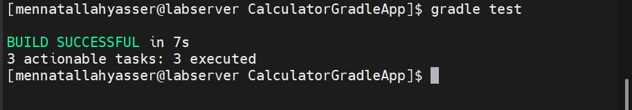
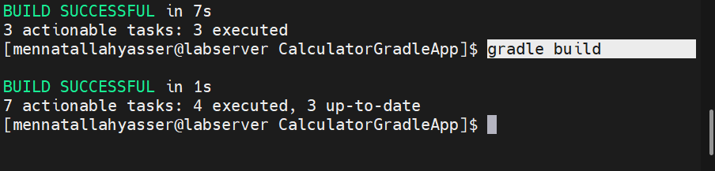
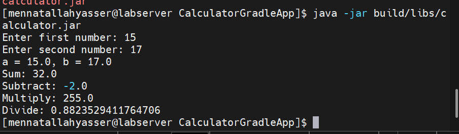

# Lab 2: Building and Packaging Java Application with Gradle

## 1. Install Gradle

```bash
gradle -v
```

```
Gradle 8.10.2
Launcher JVM:  17.0.20.1 (Eclipse Adoptium 17.0.20.1+1)
```

## 2. Clone source code

```bash
git clone https://github.com/Ibrahim-Adel15/CalculatorGradleApp.git
cd CalculatorGradleApp
```

## 3. Run unit test

```bash
gradle test
```



## 4. Build app

```bash
gradle build
```

Generates `build/libs/calculator.jar`.



## 5. Run app and verify it is working

```bash
java -jar build/libs/calculator.jar
```


