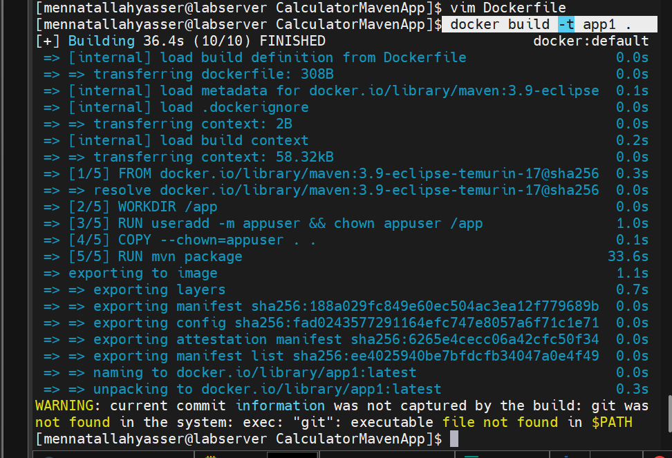
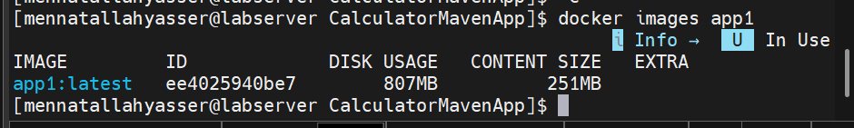
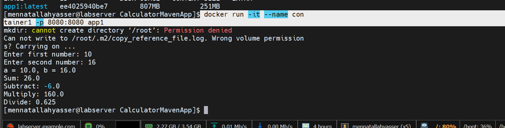
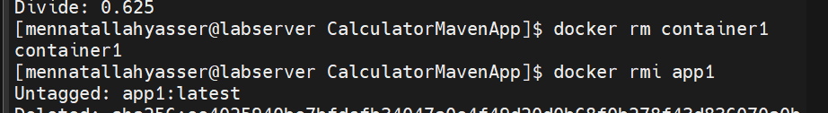
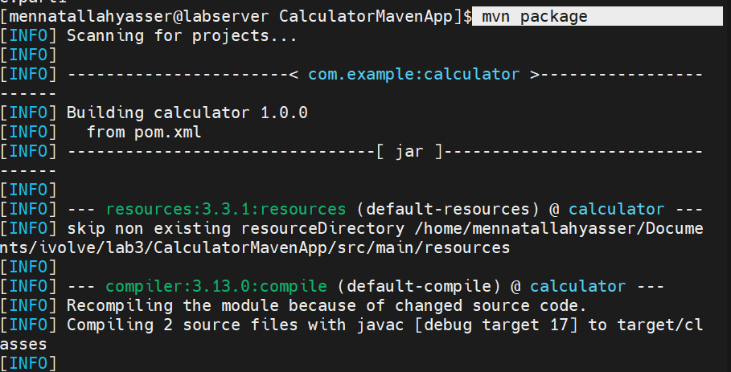
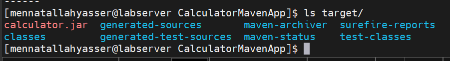
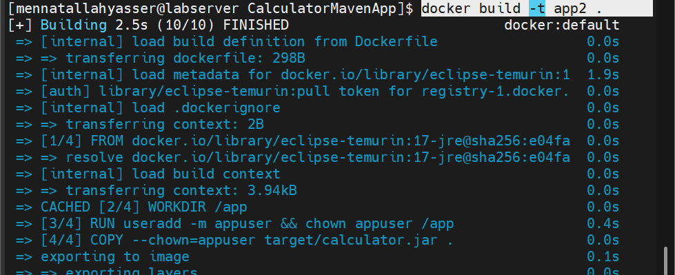
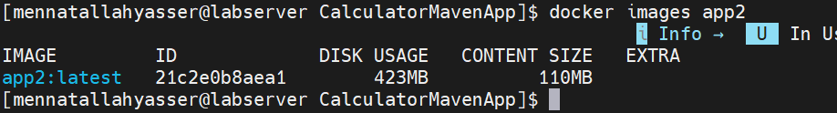
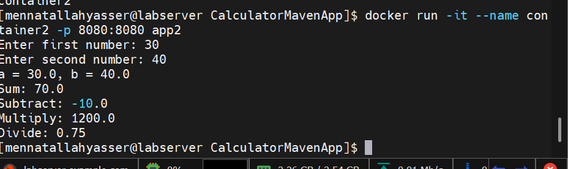
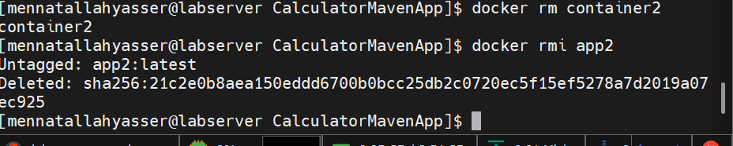

# Lab 3: Creating a Docker Image for a Java Application

## Clone source code

```bash
git clone https://github.com/Ibrahim-Adel15/CalculatorMavenApp.git
cd CalculatorMavenApp
```

## Part 1: Build Inside Docker

[Dockerfile.part1](Dockerfile.part1)

```dockerfile
FROM maven:3.9-eclipse-temurin-17

WORKDIR /app

RUN useradd -m appuser && chown appuser /app
USER appuser

COPY --chown=appuser . .

RUN mvn package

EXPOSE 8080

CMD ["java", "-jar", "target/calculator.jar"]
```

### Build image app1

```bash
docker build -f Dockerfile.part1 -t app1 .
```



### Image size

```bash
docker images app1
```



### Run container1 and verify

```bash
docker run -it --name container1 -p 8080:8080 app1
```



### Delete container and image

```bash
docker rm container1
docker rmi app1
```



## Part 2: Build Locally

### Build app locally with Maven

```bash
mvn package
ls target/
```





[Dockerfile](Dockerfile)

```dockerfile
FROM eclipse-temurin:17-jre

WORKDIR /app

RUN useradd -m appuser && chown appuser /app
USER appuser

COPY --chown=appuser target/calculator.jar .

EXPOSE 8080

CMD ["java", "-jar", "calculator.jar"]
```

### Build image app2

```bash
docker build -t app2 .
```



### Image size

```bash
docker images app2
```



### Run container2 and verify

```bash
docker run -it --name container2 -p 8080:8080 app2
```



### Delete container and image

```bash
docker rm container2
docker rmi app2
```



## Bonus: Image size comparison

| Image | Base image | Disk usage | Content size |
|---|---|---|---|
| app1 | `maven:3.9-eclipse-temurin-17` | 807MB | 251MB |
| app2 | `eclipse-temurin:17-jre` | 423MB | 110MB |

- **app1** builds the app inside the image, so it carries Maven, the full JDK (compiler included), the source code, and the downloaded Maven dependencies, none of which are needed to run the app.
- **app2** only copies the already-built `calculator.jar` onto a Java runtime (JRE) image, which is all the app needs to run, so it is about half the size.
- Smaller images are faster to pull and push, use less disk, and have fewer packages that could contain vulnerabilities.
