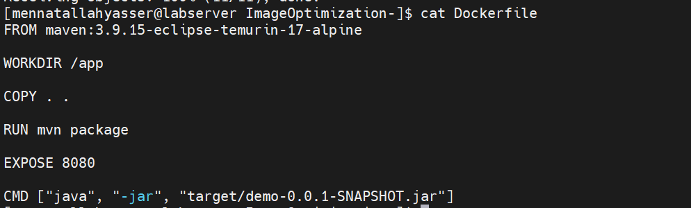
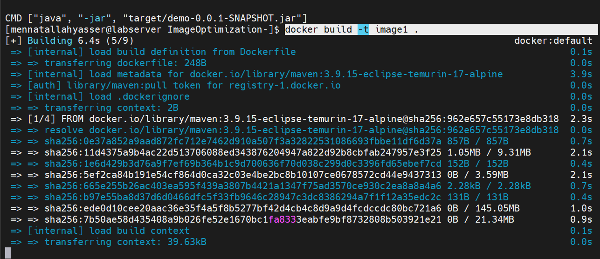
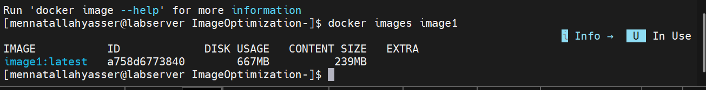
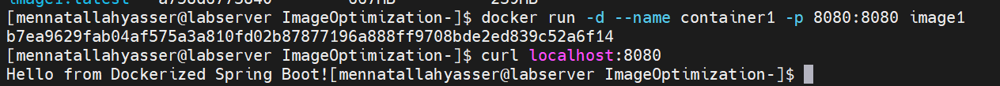
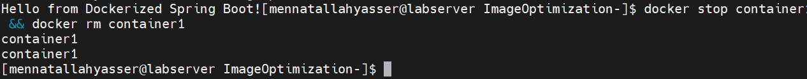
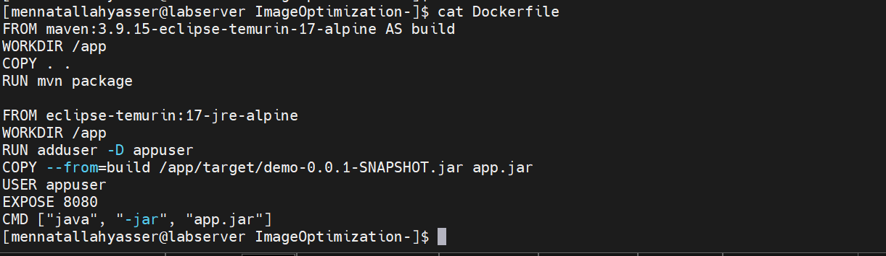
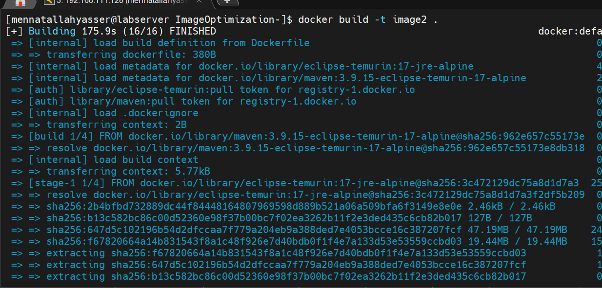
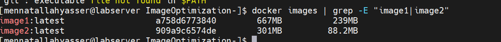
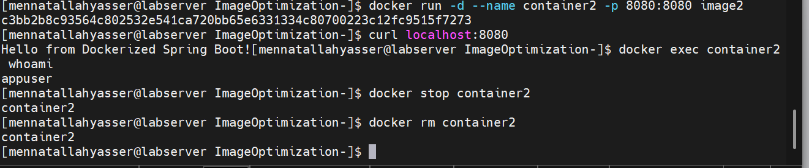
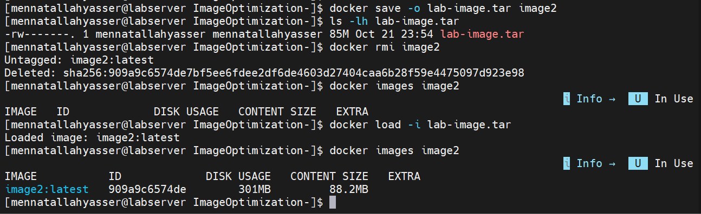

# Lab 4: Docker Image Optimization and Export/Load

## 1. Clone source code and build image1

```bash
git clone https://github.com/Ibrahim-Adel15/ImageOptimization-.git
cd ImageOptimization-
cat Dockerfile
```



```bash
docker build -t image1 .
```



## 2. Note image size and run container1

```bash
docker images image1
```



```bash
docker run -d --name container1 -p 8080:8080 image1
curl localhost:8080
```



## 3. Stop and delete container1

```bash
docker stop container1 && docker rm container1
```



## 4. Multi-stage Dockerfile with non-root user

[Dockerfile](Dockerfile)

```dockerfile
FROM maven:3.9.15-eclipse-temurin-17-alpine AS build
WORKDIR /app
COPY . .
RUN mvn package

FROM eclipse-temurin:17-jre-alpine
WORKDIR /app
RUN adduser -D appuser
COPY --from=build /app/target/demo-0.0.1-SNAPSHOT.jar app.jar
USER appuser
EXPOSE 8080
CMD ["java", "-jar", "app.jar"]
```



## 5. Build image2 and compare size

```bash
docker build -t image2 .
docker images | grep -E "image1|image2"
```





| Image | Disk usage | Content size |
|---|---|---|
| image1 (single-stage) | 667MB | 239MB |
| image2 (multi-stage) | 301MB | 88.2MB |

## 6. Run container2, verify app and non-root user, then delete it

```bash
docker run -d --name container2 -p 8080:8080 image2
curl localhost:8080
docker exec container2 whoami
docker stop container2
docker rm container2
```



## 7. Save, delete and load image2

```bash
docker save -o lab-image.tar image2
ls -lh lab-image.tar
docker rmi image2
docker images image2
docker load -i lab-image.tar
docker images image2
```


