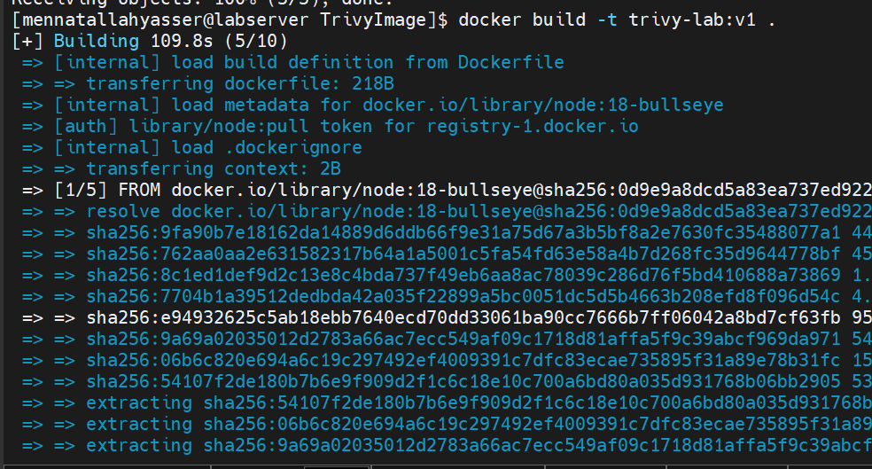
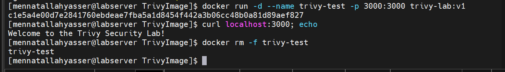
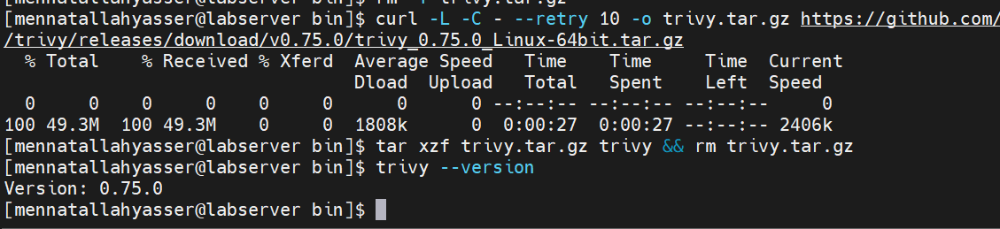
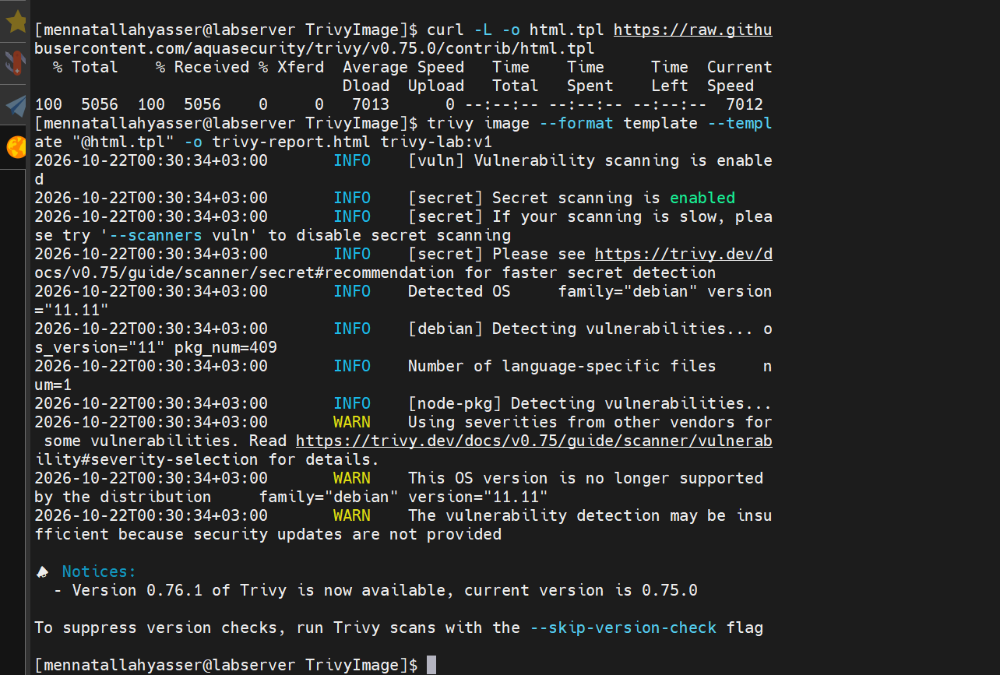
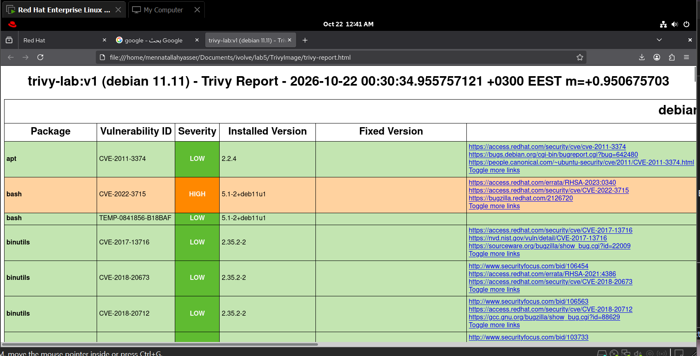
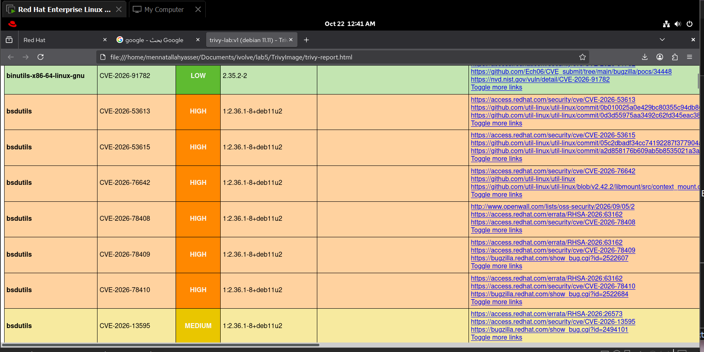
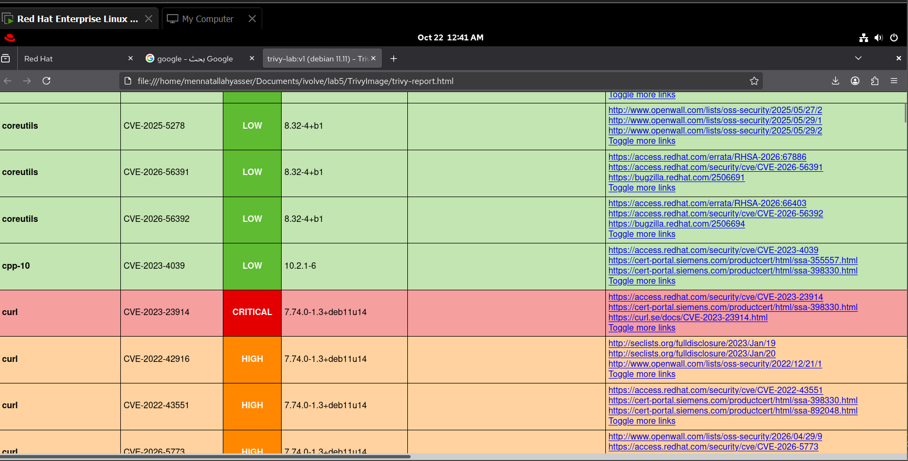

# Lab 5: Docker Image Vulnerability Scanning with Trivy

## 1. Clone source code

```bash
git clone https://github.com/Ibrahim-Adel15/TrivyImage.git
cd TrivyImage
```

## 2. Build image trivy-lab:v1

```bash
docker build -t trivy-lab:v1 .
```



```bash
docker run -d --name trivy-test -p 3000:3000 trivy-lab:v1
curl localhost:3000
docker rm -f trivy-test
```



## 3. Install Trivy and verify

```bash
cd ~/.local/bin
curl -L -o trivy.tar.gz https://github.com/aquasecurity/trivy/releases/download/v0.75.0/trivy_0.75.0_Linux-64bit.tar.gz
tar xzf trivy.tar.gz trivy && rm trivy.tar.gz
trivy --version
```



## 4. Scan the image for vulnerabilities

```bash
trivy image trivy-lab:v1
```


## 5. Scan for HIGH and CRITICAL vulnerabilities only

```bash
trivy image --severity HIGH,CRITICAL trivy-lab:v1
```


## 6. Generate HTML report

```bash
curl -L -o html.tpl https://raw.githubusercontent.com/aquasecurity/trivy/v0.75.0/contrib/html.tpl
trivy image --format template --template "@html.tpl" -o trivy-report.html trivy-lab:v1
```








