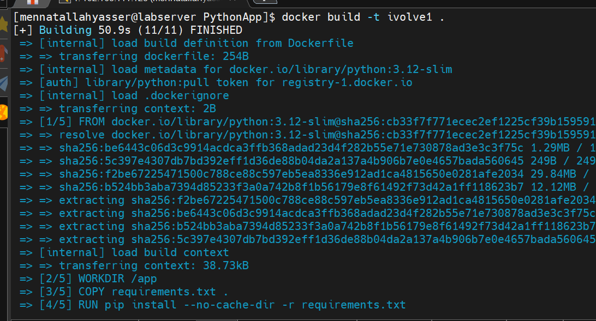
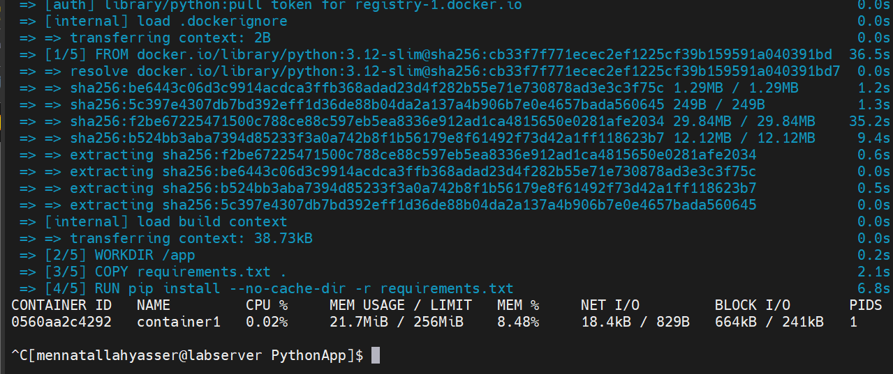
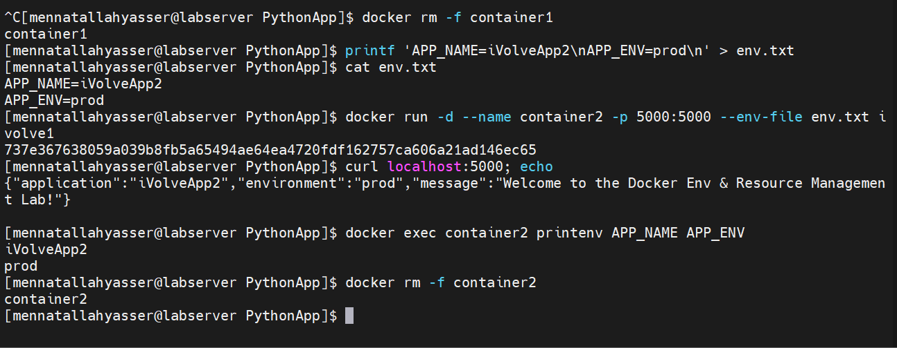
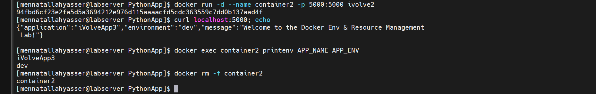

# Lab 6: Docker Environment Variables and Resource Management

## 1. Clone source code

```bash
git clone https://github.com/Ibrahim-Adel15/PythonApp.git
cd PythonApp
```

## 2. Dockerfile

[Dockerfile](Dockerfile)

```dockerfile
FROM python:3.12-slim
WORKDIR /app
COPY requirements.txt .
RUN pip install --no-cache-dir -r requirements.txt
COPY . .
EXPOSE 5000
CMD ["python", "app.py"]
```

## 3. Build ivolve1 image

```bash
docker build -t ivolve1 .
```



## 4. Run container1 with env variables and resource limits (1 CPU, 256MB)

```bash
docker run -d --name container1 -p 5000:5000 -e APP_NAME=iVolveApp1 -e APP_ENV=stg --cpus=1 --memory=256m ivolve1
curl localhost:5000
docker exec container1 printenv APP_NAME APP_ENV
```

> Note: I forgot to take a screenshot of this step.

## 5. Monitor CPU and memory usage

```bash
docker stats container1
```



## 6. Run container2 with env.txt

[env.txt](env.txt)

```bash
docker rm -f container1
printf 'APP_NAME=iVolveApp2\nAPP_ENV=prod\n' > env.txt
docker run -d --name container2 -p 5000:5000 --env-file env.txt ivolve1
curl localhost:5000
docker exec container2 printenv APP_NAME APP_ENV
docker rm -f container2
```



## 7. Image with env variables hardcoded in Dockerfile

[Dockerfile.env](Dockerfile.env)

```dockerfile
FROM python:3.12-slim
WORKDIR /app
ENV APP_NAME=iVolveApp3 APP_ENV=dev
COPY requirements.txt .
RUN pip install --no-cache-dir -r requirements.txt
COPY . .
EXPOSE 5000
CMD ["python", "app.py"]
```

```bash
docker build -f Dockerfile.env -t ivolve2 .
docker run -d --name container2 -p 5000:5000 ivolve2
curl localhost:5000
docker exec container2 printenv APP_NAME APP_ENV
docker rm -f container2
```


