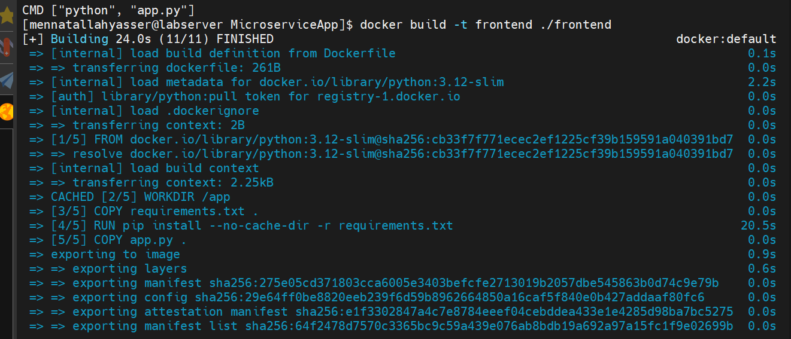
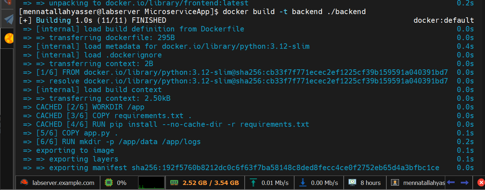
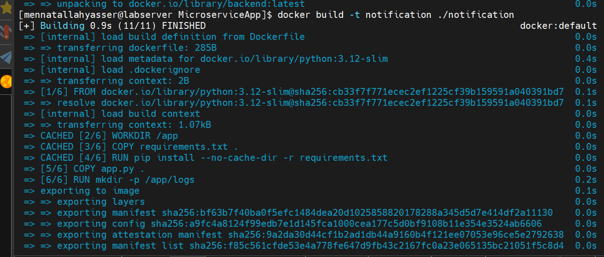
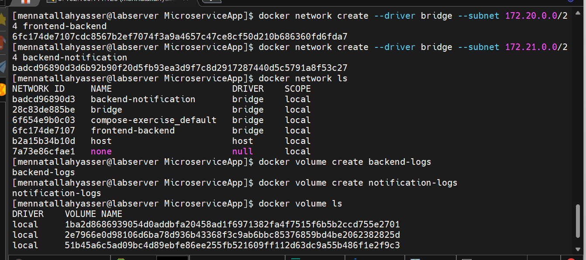
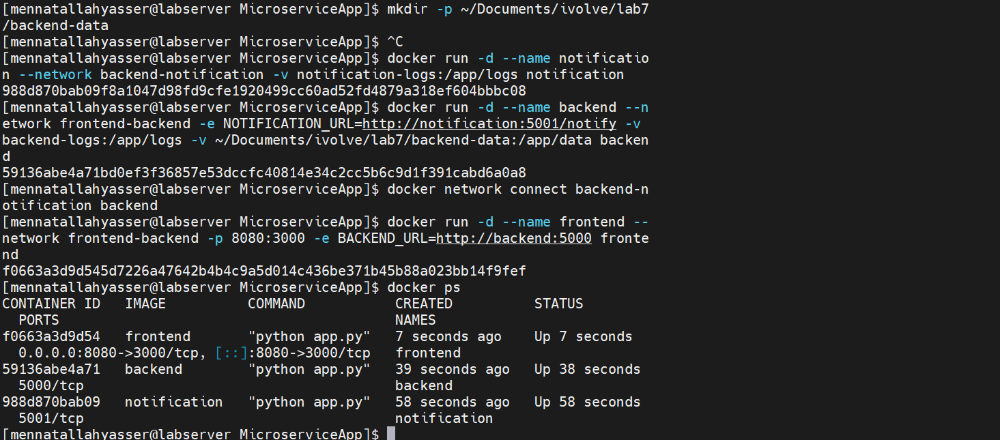
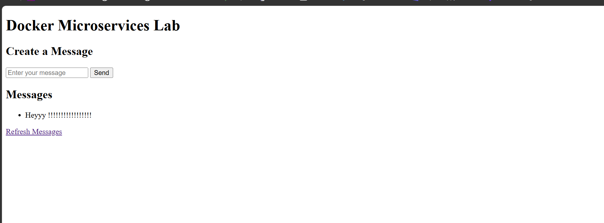
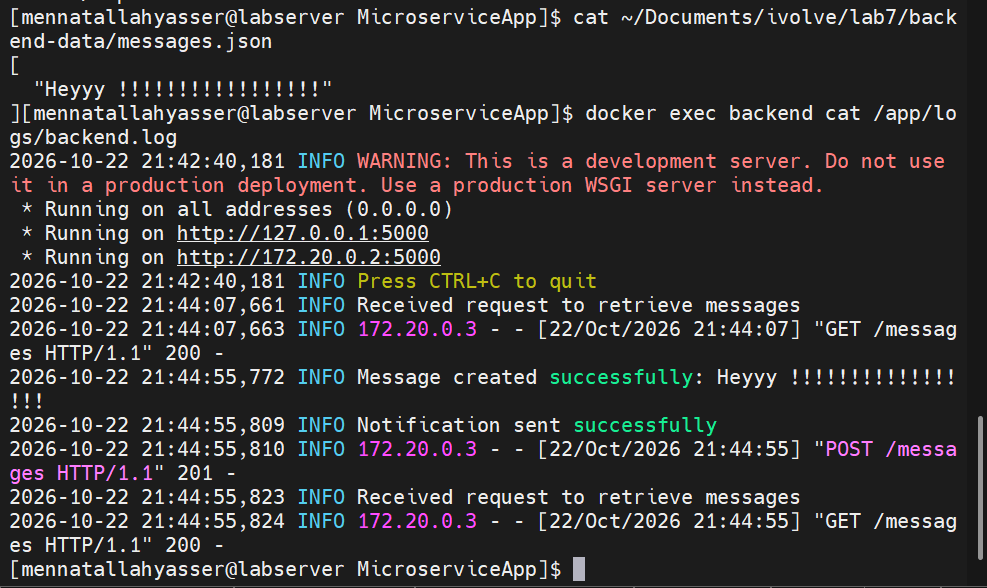
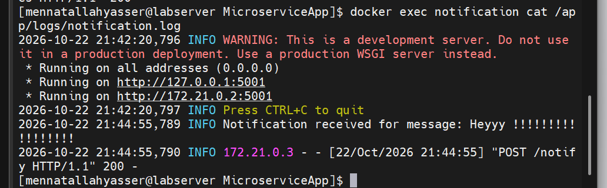

# Lab 7: Multi-Network Microservices, Volumes, and Bind Mounts

```
Browser :8080 → frontend ──(frontend-backend)──► backend ──(backend-notification)──► notification
```

## 1. Clone source code

```bash
git clone https://github.com/Ibrahim-Adel15/MicroserviceApp.git
cd MicroserviceApp
```

## 2. Build images (Dockerfiles: [frontend](frontend/Dockerfile), [backend](backend/Dockerfile), [notification](notification/Dockerfile))

```bash
docker build -t frontend ./frontend
docker build -t backend ./backend
docker build -t notification ./notification
```







## 3. Create networks and volumes

```bash
docker network create --driver bridge --subnet 172.20.0.0/24 frontend-backend
docker network create --driver bridge --subnet 172.21.0.0/24 backend-notification
docker network ls

docker volume create backend-logs
docker volume create notification-logs
docker volume ls
```



## 4. Create host directory for backend data (bind mount)

```bash
mkdir -p ~/Documents/ivolve/lab7/backend-data
```

## 5. Run the containers

```bash
docker run -d --name notification --network backend-notification \
  -v notification-logs:/app/logs notification

docker run -d --name backend --network frontend-backend \
  -e NOTIFICATION_URL=http://notification:5001/notify \
  -v backend-logs:/app/logs \
  -v ~/Documents/ivolve/lab7/backend-data:/app/data backend
docker network connect backend-notification backend

docker run -d --name frontend --network frontend-backend -p 8080:3000 \
  -e BACKEND_URL=http://backend:5000 frontend

docker ps
```



## 6. Access the web page and verify messages

`http://<server-ip>:8080`



```bash
cat ~/Documents/ivolve/lab7/backend-data/messages.json
docker exec backend cat /app/logs/backend.log
docker exec notification cat /app/logs/notification.log
```




