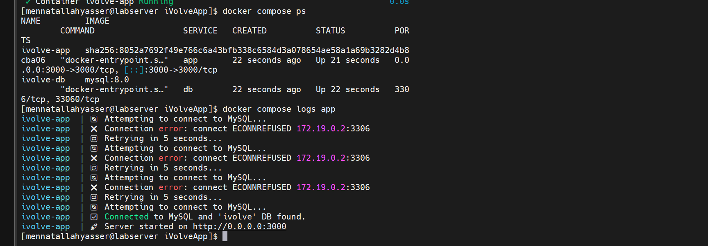
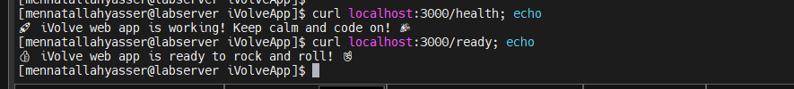
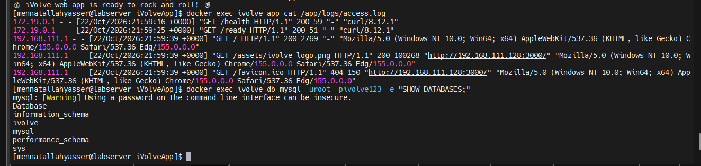
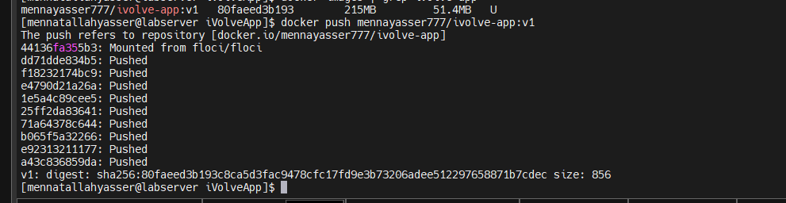

# Lab 8: Containerized Node.js and MySQL Stack Using Docker Compose

## 1. Clone source code

```bash
git clone https://github.com/Ibrahim-Adel15/iVolveApp.git
cd iVolveApp
```

## 2. docker-compose.yml

[docker-compose.yml](docker-compose.yml)

```yaml
services:
  app:
    build: .
    container_name: ivolve-app
    ports:
      - "3000:3000"
    environment:
      DB_HOST: db
      DB_USER: root
      DB_PASSWORD: ivolve123
    volumes:
      - app_logs:/app/logs
    depends_on:
      - db
    networks:
      - ivolve-net

  db:
    image: mysql:8.0
    container_name: ivolve-db
    environment:
      MYSQL_ROOT_PASSWORD: ivolve123
      MYSQL_DATABASE: ivolve
    volumes:
      - db_data:/var/lib/mysql
    networks:
      - ivolve-net

volumes:
  app_logs:
  db_data:

networks:
  ivolve-net:
```

## 3. Start the services

```bash
docker compose up -d --build
docker compose ps
docker compose logs app
```



## 4. Verify the application and DB connectivity

```bash
curl localhost:3000/health
curl localhost:3000/ready
```



```bash
docker exec ivolve-app cat /app/logs/access.log
docker exec ivolve-db mysql -uroot -pivolve123 -e "SHOW DATABASES;"
```



## 5. Tag and push the image to Docker Hub

```bash
docker login -u mennayasser777
docker tag ivolveapp-app mennayasser777/ivolve-app:v1
docker push mennayasser777/ivolve-app:v1
```

Image: https://hub.docker.com/r/mennayasser777/ivolve-app


