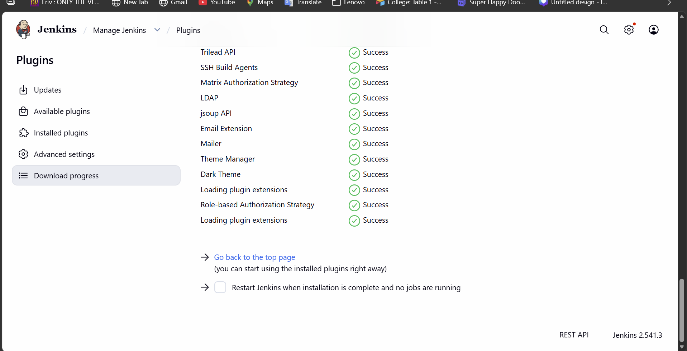
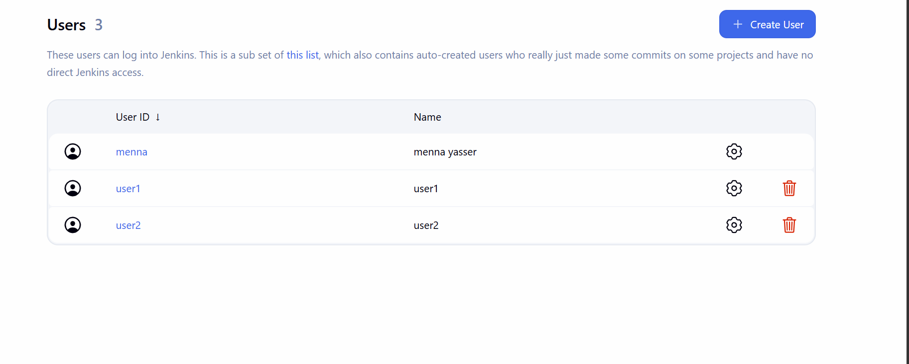
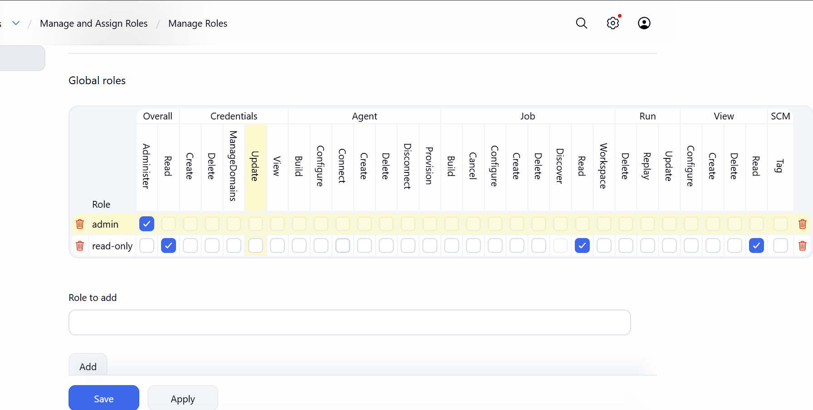
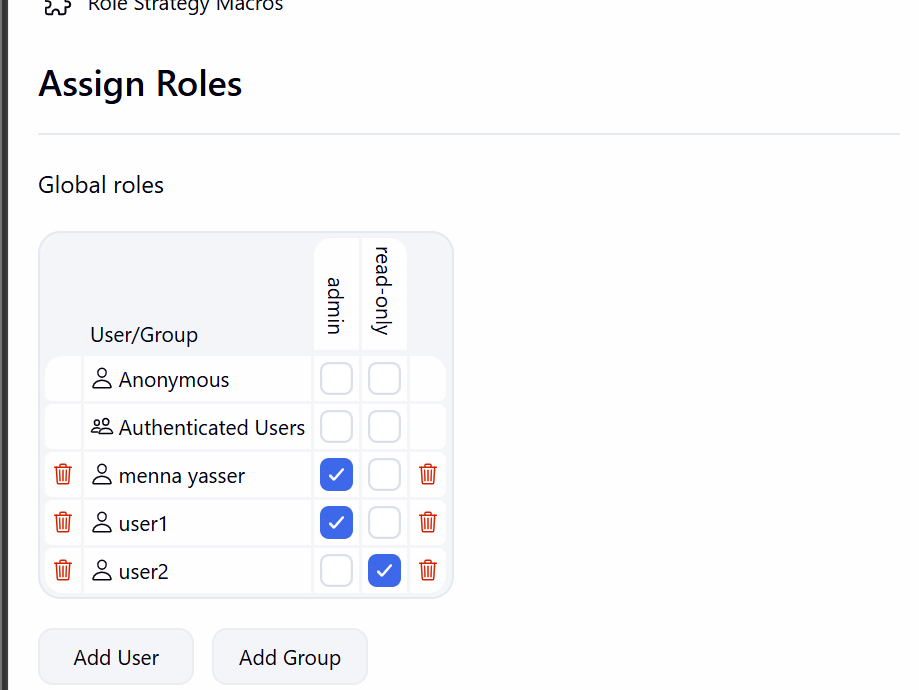

# Lab 20: Role-based Authorization

Create `user1` and `user2` in Jenkins, and give `user1` the admin role and `user2` a read-only role.

## 1. Run Jenkins

Jenkins runs in Docker on the master VM, with its data in the `jenkins_home` volume:

```bash
docker run -d --name jenkins --restart unless-stopped -p 8080:8080 -p 50000:50000 -v jenkins_home:/var/jenkins_home jenkins/jenkins:lts-jdk17
docker exec jenkins cat /var/jenkins_home/secrets/initialAdminPassword
```

Open `http://192.168.111.128:8080`, unlock it with the initial password, install the suggested plugins, and create the first admin user (`menna`).

## 2. Install the Role-based Authorization Strategy plugin

**Manage Jenkins → Plugins → Available plugins**, search `Role-based Authorization Strategy`, **Install**:



## 3. Create user1 and user2

**Manage Jenkins → Users → Create User**, once for `user1` and once for `user2`:



## 4. Enable Role-Based Strategy

**Manage Jenkins → Security → Authorization → Role-Based Strategy**, **Save**.

The user who enables it (`menna`) is given the `admin` role automatically, so the admin account is not locked out.

## 5. Create the roles

**Manage Jenkins → Manage and Assign Roles → Manage Roles → Global roles**:

- `admin`: **Overall/Administer** (all permissions; created by the plugin)
- `read-only`: **Overall/Read**, **Job/Read**, **View/Read** only



## 6. Assign the roles

**Manage Jenkins → Manage and Assign Roles → Assign Roles → Global roles**:

| User | admin | read-only |
|---|---|---|
| menna | ✅ | |
| user1 | ✅ | |
| user2 | | ✅ |

`Anonymous` and `Authenticated Users` get no role, so each user only has what is assigned to them by name.



The saved configuration in `/var/jenkins_home/config.xml`:

```bash
docker exec jenkins sh -c 'sed -n "/<authorizationStrategy/,/<\/authorizationStrategy>/p" /var/jenkins_home/config.xml'
```

```xml
<role name="admin" pattern=".*">
  <permission>hudson.model.Hudson.Administer</permission>
  <sid type="USER">user1</sid>
  <sid type="USER">menna</sid>
<role name="read-only" pattern=".*">
  <permission>hudson.model.Hudson.Read</permission>
  <permission>hudson.model.Item.Read</permission>
  <permission>hudson.model.View.Read</permission>
  <sid type="USER">user2</sid>
```
