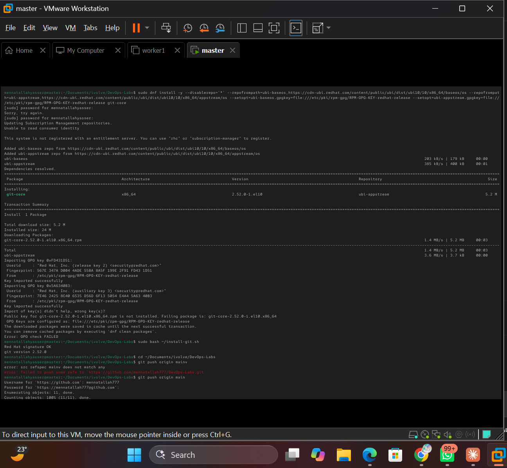
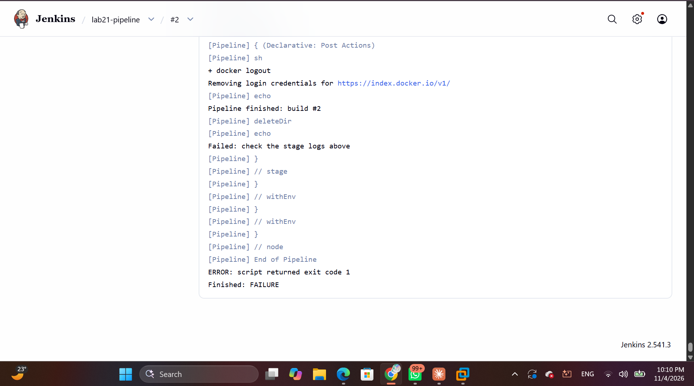
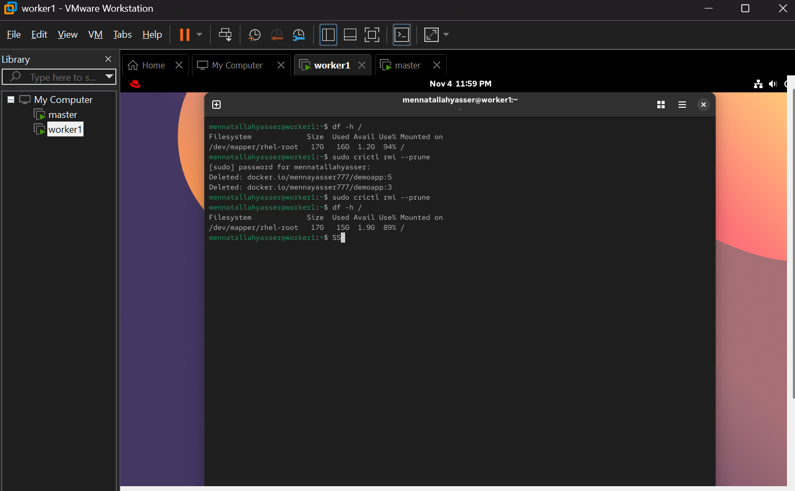
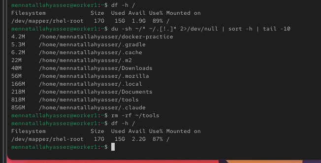
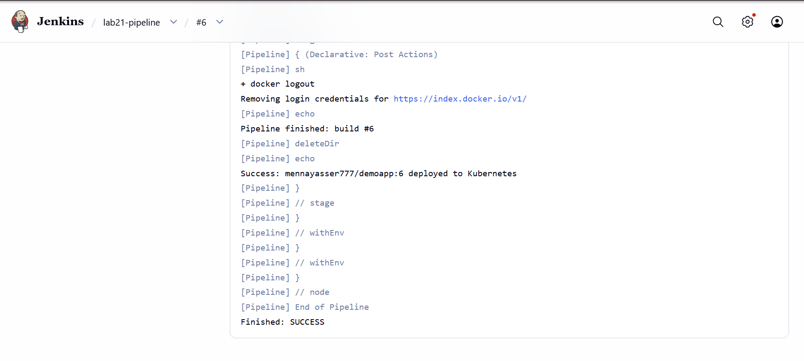

# Lab 21: Jenkins Pipeline for Application Deployment

A Jenkins pipeline that builds [DemoApp](https://github.com/Ibrahim-Adel15/DemoApp), pushes its image to DockerHub, and deploys it to the Kubernetes cluster.

## 1. Jenkins agent on the VM

Jenkins runs in a container that has no `docker`, `mvn`, `trivy` or `kubectl`. The master VM has all of them, so it is added as an agent.

**Manage Jenkins → Nodes → New Node** → `vm-agent`, Permanent Agent:

| Field | Value |
|---|---|
| Remote root directory | `/home/mennatallahyasser/jenkins-agent` |
| Labels | `vm-agent` |
| Usage | Only build jobs with label expressions matching this node |
| Launch method | Launch agent by connecting it to the controller |

Start the agent on the VM, with the secret from the node page saved in `secret-file`:

```bash
cd ~/jenkins-agent
echo <secret> > secret-file && chmod 600 secret-file
curl -sO http://192.168.111.128:8080/jnlpJars/agent.jar
nohup java -jar agent.jar -url http://192.168.111.128:8080/ -secret @secret-file -name vm-agent -webSocket -workDir /home/mennatallahyasser/jenkins-agent > agent.log 2>&1 &
```

The agent does not start on its own after the VM reboots, so run the `nohup` line again after a restart.

## 2. Install git on the agent

Jenkins needs a real `git` binary on the agent to check out code. The VM is not registered with Red Hat, so `dnf` has no repos. `git-core` comes from Red Hat's free UBI repo instead, after checking the Red Hat RSA signature on the rpm (`dnf` rejects it only because the newer post-quantum key isn't on the system):

```bash
curl -O https://cdn-ubi.redhat.com/content/public/ubi/dist/ubi10/10/x86_64/appstream/os/Packages/g/git-core-2.52.0-1.el10.x86_64.rpm
rpm -Kv git-core-2.52.0-1.el10.x86_64.rpm   # RSA/SHA256 Signature, key ID fd431d51: OK
sudo rpm -i --nosignature git-core-2.52.0-1.el10.x86_64.rpm
git --version
```



## 3. DockerHub credential

DockerHub access token saved in **Manage Jenkins → Credentials** as `Username with password`, ID `dockerhub`.

## 4. Pipeline

[`Jenkinsfile`](Jenkinsfile) runs on `vm-agent`:

| Stage | Command |
|---|---|
| Clone | `git` DemoApp into `app/` |
| Build App | `mvn clean package -DskipTests` |
| Build Docker Image | `docker build -t mennayasser777/demoapp:<build> .` |
| Scan Docker Image | `trivy image --pkg-types os --scanners vuln --severity HIGH,CRITICAL` |
| Push Image | `docker login` + `docker push` |
| Delete Image Locally | `docker rmi` |
| Update Deployment File | `sed` the new image into [`deployment.yaml`](deployment.yaml) |
| Deploy to Kubernetes | `kubectl apply` + `kubectl rollout status` |

The scan checks OS packages only: the full scan needs trivy's Java DB, which is too big for the VM's 17 GB disk.

The job is a **Pipeline** with **Pipeline script from SCM**: repo `https://github.com/mennatallah777/DevOps-Labs.git`, branch `main`, script path `Jenkins/Lab21/Jenkinsfile`.

## 5. Post actions

- `always`: `docker logout`, print the build number, clean the workspace
- `success`: print the deployed image
- `failure`: print a failure message

A failed run (build #2) still logs out and cleans up, then prints the failure message:



## 6. Disk space on worker1

The app pods were evicted with `The node was low on resource: ephemeral-storage`, and worker1 got the `disk-pressure` taint. Unused images were removed on worker1, along with the build tools in `~/tools` (worker1 only runs pods, it doesn't build):

```bash
sudo crictl rmi --prune
rm -rf ~/tools
df -h /
```





## 7. Result



```bash
kubectl get pods -l app=demoapp
curl http://192.168.111.129:30080
```

```
Hello from Dockerized Spring Boot!
```
