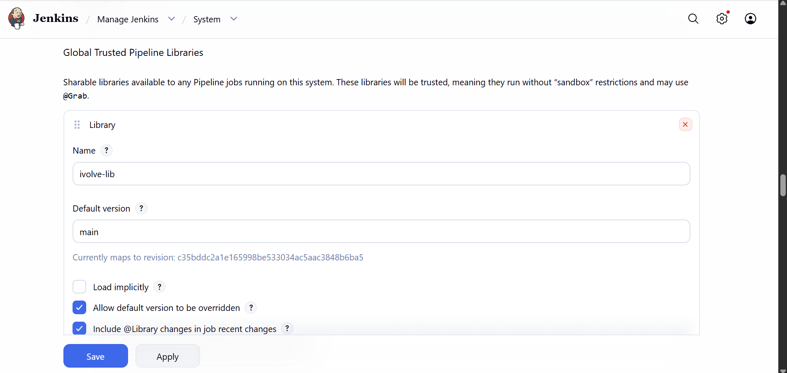
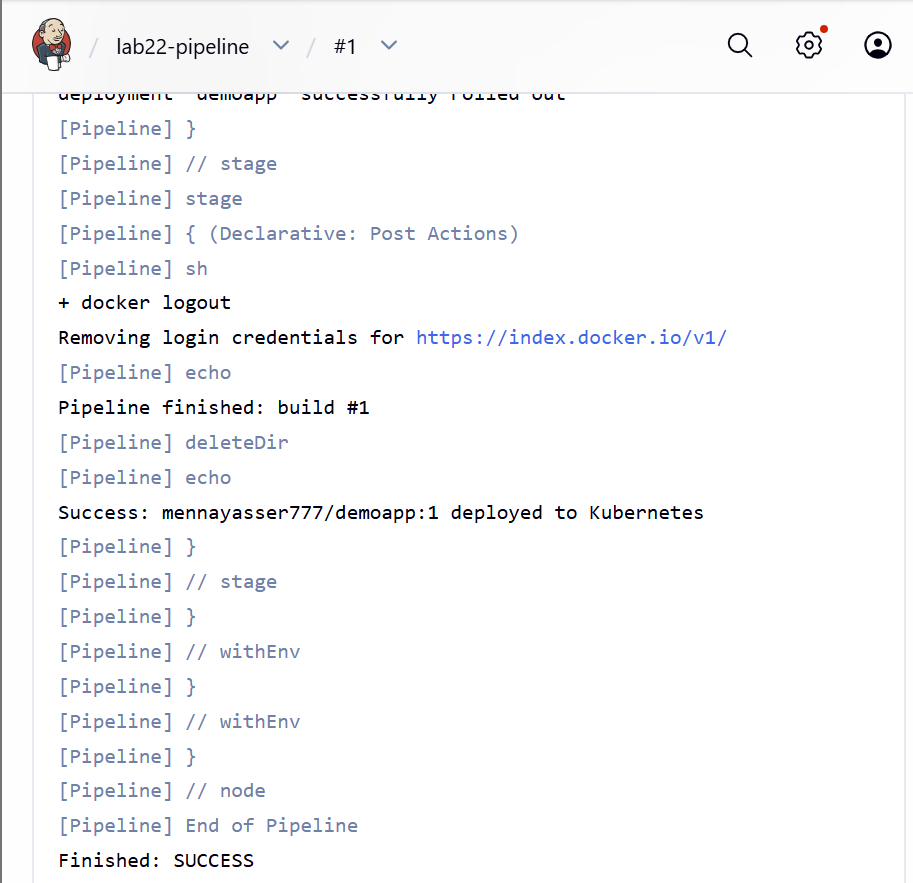

# Lab 22: CI/CD Pipeline with Jenkins Agents and Shared Libraries

The [Lab 21](../Lab21) pipeline, split into three shared library steps and run on the `vm-agent` agent.

## 1. Shared library

The library lives in [`shared-library/`](shared-library). Each file in `vars/` becomes a step the pipeline can call:

| Step | File | Does |
|---|---|---|
| `BuildApp` | [`BuildApp.groovy`](shared-library/vars/BuildApp.groovy) | `mvn test`, then `mvn clean package` |
| `BuildImage` | [`BuildImage.groovy`](shared-library/vars/BuildImage.groovy) | `docker build`, `trivy image`, `docker push`, `docker rmi` |
| `DeployOnK8s` | [`DeployOnK8s.groovy`](shared-library/vars/DeployOnK8s.groovy) | `sed` the image into the deployment file, `kubectl apply`, `kubectl rollout status` |

Registered in **Manage Jenkins → System → Global Trusted Pipeline Libraries**:

| Field | Value |
|---|---|
| Name | `ivolve-lib` |
| Default version | `main` |
| Retrieval method | Modern SCM → Git |
| Project Repository | `https://github.com/mennatallah777/DevOps-Labs.git` |
| Library Path | `Jenkins/Lab22/shared-library/` |



## 2. Pipeline

[`Jenkinsfile`](Jenkinsfile) loads the library with `@Library('ivolve-lib') _` and calls the steps:

```groovy
BuildApp('app')
BuildImage(image: env.IMAGE, tag: env.TAG, credentialsId: 'dockerhub', appDir: 'app')
DeployOnK8s(image: env.IMAGE, tag: env.TAG, file: 'Jenkins/Lab22/deployment.yaml', deployment: 'demoapp')
```

Post actions are the same as Lab 21: `always` logs out and cleans the workspace, `success` and `failure` print the result.

The job `lab22-pipeline` is a **Pipeline** with **Pipeline script from SCM**: repo `https://github.com/mennatallah777/DevOps-Labs.git`, branch `main`, script path `Jenkins/Lab22/Jenkinsfile`.

The build log shows `Loading library ivolve-lib@main:Jenkins/Lab22/shared-library/`, then each step's commands. DemoApp has no unit tests, so `mvn test` prints `No tests to run`.



## 3. Agent

The pipeline runs on `vm-agent` (`agent { label 'vm-agent' }`), the agent set up in [Lab 21](../Lab21#1-jenkins-agent-on-the-vm). It runs directly on the master VM, which has `git`, `mvn`, `docker`, `trivy` and `kubectl`.
