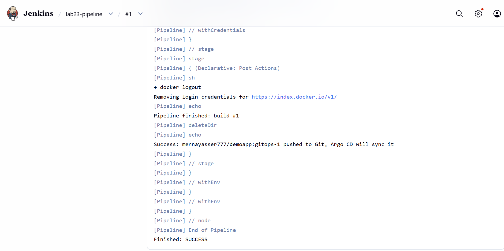
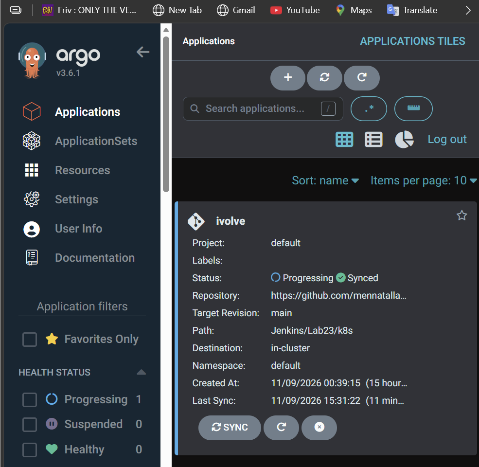

# Lab 23: GitOps Workflow with Jenkins and Argo CD

Jenkins builds and pushes the image, then commits the new image tag to Git. Argo CD watches the manifest folder in Git and syncs the change to the cluster.

```
Jenkins: build → scan → push image → edit k8s/deployment.yaml → git push
Argo CD: sees the new commit → kubectl apply (automatic sync)
```

## 1. Make room on the nodes

Both VMs have 17 GB disks, so the Lab 18 monitoring stack was paused first (nothing deleted), and unused images were removed on worker1:

```bash
kubectl scale deploy -n monitoring prometheus grafana alertmanager --replicas=0
sudo crictl rmi --prune     # on worker1
```

To bring monitoring back: `kubectl scale deploy -n monitoring prometheus grafana alertmanager --replicas=1`.

## 2. Install Argo CD

[`install-argocd.sh`](install-argocd.sh) installs the `stable` Argo CD manifests into the `argocd` namespace, scales down the parts this lab doesn't use (dex, notifications, ApplicationSets), exposes the UI on NodePort `30443`, and prints the admin password:

```bash
bash install-argocd.sh
```

UI: `https://192.168.111.129:30443`, user `admin`, password from `argocd-initial-admin-secret`.

## 3. Connect the GitHub repo

**Settings → Repositories → Connect Repo**: HTTPS, project `default`, URL `https://github.com/mennatallah777/DevOps-Labs.git` (public, no credentials).

## 4. Application `ivolve`

[`argocd-app.yaml`](argocd-app.yaml) watches [`k8s/`](k8s) on `main` and deploys it to the `default` namespace, with automatic sync (`prune` and `selfHeal`):

```bash
kubectl apply -f argocd-app.yaml
```

## 5. DeployOnK8s pushes to Git

[`DeployOnK8s`](../Lab22/shared-library/vars/DeployOnK8s.groovy) in the Lab 22 shared library got a `gitPush` option. With `gitPush: true` it edits the deployment file, then commits and pushes it to GitHub instead of running `kubectl apply`. Lab 22 still calls it without `gitPush`, so it keeps deploying with `kubectl`.

The push uses a GitHub token saved in Jenkins as `Username with password`, ID `github`.

[`Jenkinsfile`](Jenkinsfile) tags images `gitops-<build>` and calls:

```groovy
DeployOnK8s(image: env.IMAGE, tag: env.TAG, file: 'Jenkins/Lab23/k8s/deployment.yaml',
            gitPush: true, credentialsId: 'github', repo: 'github.com/mennatallah777/DevOps-Labs.git')
```

The job `lab23-pipeline` is a **Pipeline** with **Pipeline script from SCM**: repo `https://github.com/mennatallah777/DevOps-Labs.git`, branch `main`, script path `Jenkins/Lab23/Jenkinsfile`.

## 6. Result

Build #1 pushed `mennayasser777/demoapp:gitops-1` to DockerHub and committed the new tag to GitHub (`Deploy mennayasser777/demoapp:gitops-1 [skip ci]`):



Argo CD picks up the Jenkins commit (it polls Git every 3 minutes), shows `ivolve` as `OutOfSync`, then syncs it automatically. Right after the sync the new pods are still starting, so it shows `Progressing`:



Once the rollout finishes:

```bash
kubectl get application ivolve -n argocd
kubectl get pods -l app=demoapp -o custom-columns=NAME:.metadata.name,IMAGE:.spec.containers[0].image
```

```
NAME     SYNC STATUS   HEALTH STATUS
ivolve   Synced        Healthy

NAME                       IMAGE
demoapp-5c486769ff-42bgz   mennayasser777/demoapp:gitops-1
demoapp-5c486769ff-vb7sx   mennayasser777/demoapp:gitops-1
```

Jenkins now commits to `main`, so pull before pushing from the VM: `git pull origin main`.
