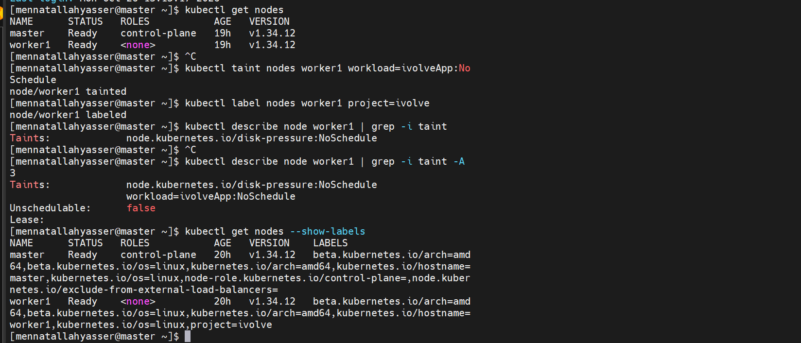

# Lab 10: Node Isolation Using Taints and Labels

Dedicate `worker1` to the ivolve application:

- A **taint** keeps other pods off the node unless they have a matching toleration.
- A **label** lets the ivolve pods find and select the node (with `nodeSelector` or node affinity).

## 1. Find the worker node

```bash
kubectl get nodes
```

The cluster has `master` (control-plane) and `worker1` (worker).

## 2. Taint the worker node

```bash
kubectl taint nodes worker1 workload=ivolveApp:NoSchedule
```

- `workload`: the key
- `ivolveApp`: the value
- `NoSchedule`: new pods are not scheduled on the node unless they tolerate the taint (pods already running stay)

A pod that should run on this node needs a matching toleration:

```yaml
tolerations:
- key: "workload"
  operator: "Equal"
  value: "ivolveApp"
  effect: "NoSchedule"
```

## 3. Label the worker node

```bash
kubectl label nodes worker1 project=ivolve
```

Pods can then target the node with:

```yaml
nodeSelector:
  project: ivolve
```

## 4. Verify

Check the taint (`-A 3` also prints the lines after `Taints:`, since each extra taint is on its own line):

```bash
kubectl describe node worker1 | grep -i taint -A 3
```

Check the label:

```bash
kubectl get nodes --show-labels
```

`worker1` has the taint `workload=ivolveApp:NoSchedule` and the label `project=ivolve`:



> The `node.kubernetes.io/disk-pressure:NoSchedule` taint was added automatically by Kubernetes because `worker1` was low on disk space. It is removed automatically once space is freed.
