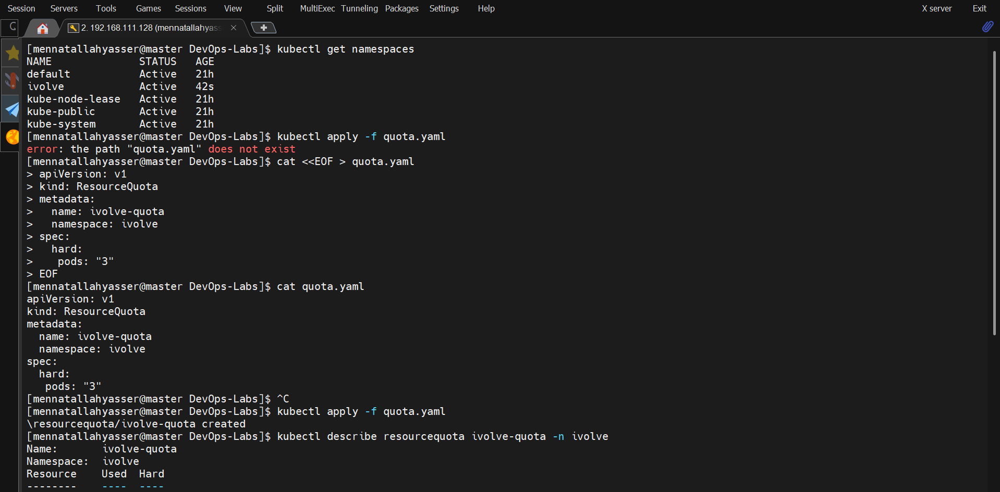
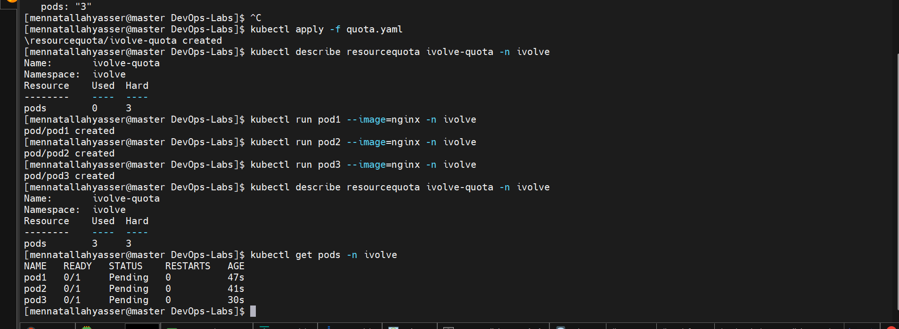
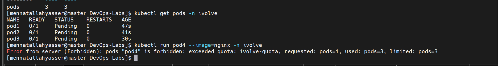

# Lab 11: Namespace Management and Resource Quota Enforcement

Isolate the application in its own namespace and limit it to 3 pods.

- A **namespace** groups resources and keeps them separate from the rest of the cluster.
- A **ResourceQuota** sets limits on a namespace. Kubernetes rejects any request that would go over the limit.

> The lab names the quota `ivolveQuota`, but Kubernetes object names must be lowercase, so it is named `ivolve-quota`.

## 1. Create the namespace

```bash
kubectl create namespace ivolve
kubectl get namespaces
```

## 2. Create the ResourceQuota

[quota.yaml](quota.yaml):

```yaml
apiVersion: v1
kind: ResourceQuota
metadata:
  name: ivolve-quota
  namespace: ivolve
spec:
  hard:
    pods: "3"
```

```bash
kubectl apply -f quota.yaml
```

## 3. Verify the quota

```bash
kubectl describe resourcequota ivolve-quota -n ivolve
```

`Used` is `0` and `Hard` is `3`:



## 4. Fill the namespace with 3 pods

```bash
kubectl run pod1 --image=nginx -n ivolve
kubectl run pod2 --image=nginx -n ivolve
kubectl run pod3 --image=nginx -n ivolve
kubectl describe resourcequota ivolve-quota -n ivolve
kubectl get pods -n ivolve
```

The quota is now full (`3/3`):



> The pods are `Pending` because `worker1` is tainted (Lab 10) and the control plane does not run normal pods. The quota still counts `Pending` pods.

## 5. Try to create a 4th pod

```bash
kubectl run pod4 --image=nginx -n ivolve
```

Kubernetes rejects it:

```
Error from server (Forbidden): pods "pod4" is forbidden: exceeded quota: ivolve-quota, requested: pods=1, used: pods=3, limited: pods=3
```


