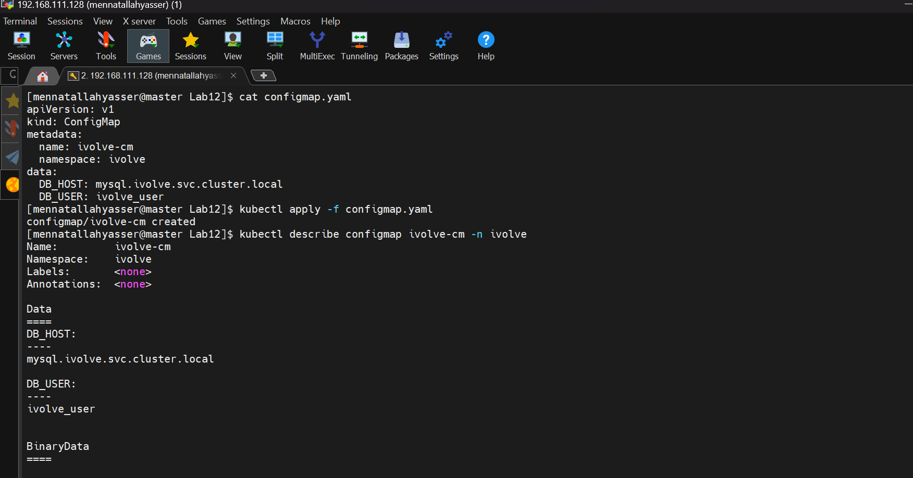
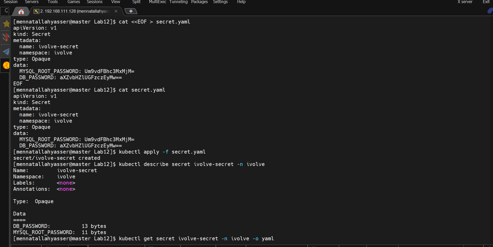
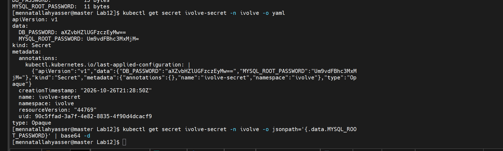

# Lab 12: Managing Configuration and Sensitive Data with ConfigMaps and Secrets

Store the MySQL connection settings outside the application, in the `ivolve` namespace:

- A **ConfigMap** holds non-sensitive settings.
- A **Secret** holds sensitive data such as passwords.

| Key | Stored in | Value |
|---|---|---|
| `DB_HOST` | ConfigMap | Hostname of the MySQL StatefulSet's headless Service |
| `DB_USER` | ConfigMap | Application database user |
| `MYSQL_ROOT_PASSWORD` | Secret | MySQL root password |
| `DB_PASSWORD` | Secret | Password of `DB_USER` |

> The lab names them `ivolveCM` and `ivolveSecret`, but Kubernetes object names must be lowercase, so they are named `ivolve-cm` and `ivolve-secret`.

## 1. Create the ConfigMap

[configmap.yaml](configmap.yaml):

```yaml
apiVersion: v1
kind: ConfigMap
metadata:
  name: ivolve-cm
  namespace: ivolve
data:
  DB_HOST: mysql.ivolve.svc.cluster.local
  DB_USER: ivolve_user
```

`DB_HOST` follows the Service DNS format `<service>.<namespace>.svc.cluster.local`, for the headless Service `mysql` that will be created with the MySQL StatefulSet.

```bash
kubectl apply -f configmap.yaml
kubectl describe configmap ivolve-cm -n ivolve
```



## 2. Encode the passwords with Base64

```bash
echo -n 'RootPass123' | base64      # Um9vdFBhc3MxMjM=
echo -n 'ivolvePass123' | base64    # aXZvbHZlUGFzczEyMw==
```

`-n` stops `echo` from adding a newline, which would otherwise become part of the password.

## 3. Create the Secret

[secret.yaml](secret.yaml):

```yaml
apiVersion: v1
kind: Secret
metadata:
  name: ivolve-secret
  namespace: ivolve
type: Opaque
data:
  MYSQL_ROOT_PASSWORD: Um9vdFBhc3MxMjM=
  DB_PASSWORD: aXZvbHZlUGFzczEyMw==
```

```bash
kubectl apply -f secret.yaml
kubectl describe secret ivolve-secret -n ivolve
```

`describe` hides the values and only shows their size:



## 4. Base64 is encoding, not encryption

```bash
kubectl get secret ivolve-secret -n ivolve -o yaml
kubectl get secret ivolve-secret -n ivolve -o jsonpath='{.data.MYSQL_ROOT_PASSWORD}' | base64 -d
```

The value decodes back to `RootPass123`. Secrets are protected by access control (RBAC), not by Base64.



> These are example lab passwords. Real passwords should not be committed to Git.
