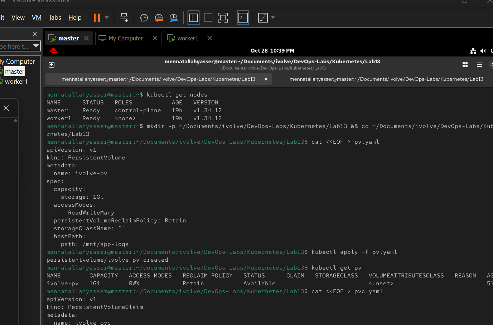
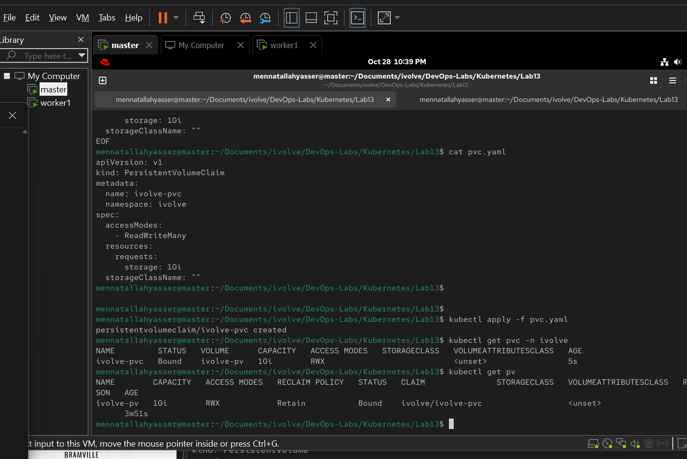

# Lab 13: Persistent Storage Setup for Application Logging

Give the application a place to keep its log files that survives pod restarts.

- A **PersistentVolume (PV)** is the storage itself: here, a folder on the node's disk.
- A **PersistentVolumeClaim (PVC)** is a request for storage. Kubernetes binds it to a matching PV, and pods use the PVC.

> The lab names them `ivolvePV` and `ivolvePVC`, but Kubernetes object names must be lowercase, so they are named `ivolve-pv` and `ivolve-pvc`.

## 1. Create the folder on the node (worker1)

The app pods run on `worker1` (Lab 10), so the `hostPath` folder is created there:

```bash
sudo mkdir -p /mnt/app-logs && sudo chmod 777 /mnt/app-logs
```

## 2. Create the PersistentVolume (master)

[pv.yaml](pv.yaml):

```yaml
apiVersion: v1
kind: PersistentVolume
metadata:
  name: ivolve-pv
spec:
  capacity:
    storage: 1Gi
  accessModes:
    - ReadWriteMany
  persistentVolumeReclaimPolicy: Retain
  storageClassName: ""
  hostPath:
    path: /mnt/app-logs
```

- `ReadWriteMany`: all app replicas can read and write at the same time
- `Retain`: the data is kept when the PVC is deleted
- `storageClassName: ""`: no StorageClass is used
- A PV is cluster-wide, so it has no namespace

```bash
kubectl apply -f pv.yaml
kubectl get pv
```

The PV is `Available`:



## 3. Create the PersistentVolumeClaim

[pvc.yaml](pvc.yaml):

```yaml
apiVersion: v1
kind: PersistentVolumeClaim
metadata:
  name: ivolve-pvc
  namespace: ivolve
spec:
  accessModes:
    - ReadWriteMany
  resources:
    requests:
      storage: 1Gi
  storageClassName: ""
```

The access mode, size and (empty) StorageClass match the PV.

```bash
kubectl apply -f pvc.yaml
kubectl get pvc -n ivolve
kubectl get pv
```

## 4. Verify

The PVC is `Bound` to `ivolve-pv`, and the PV's claim is `ivolve/ivolve-pvc`:


