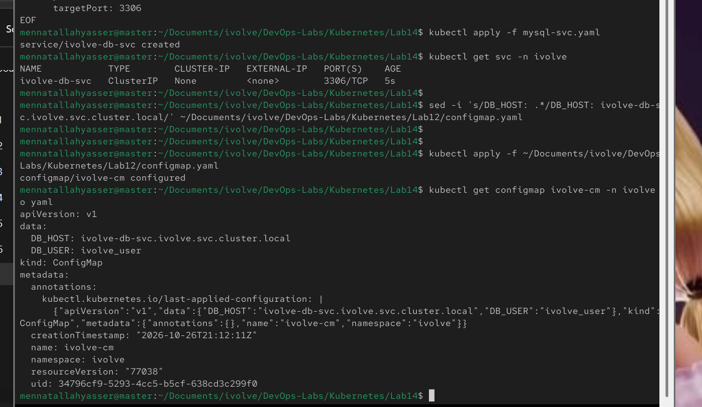
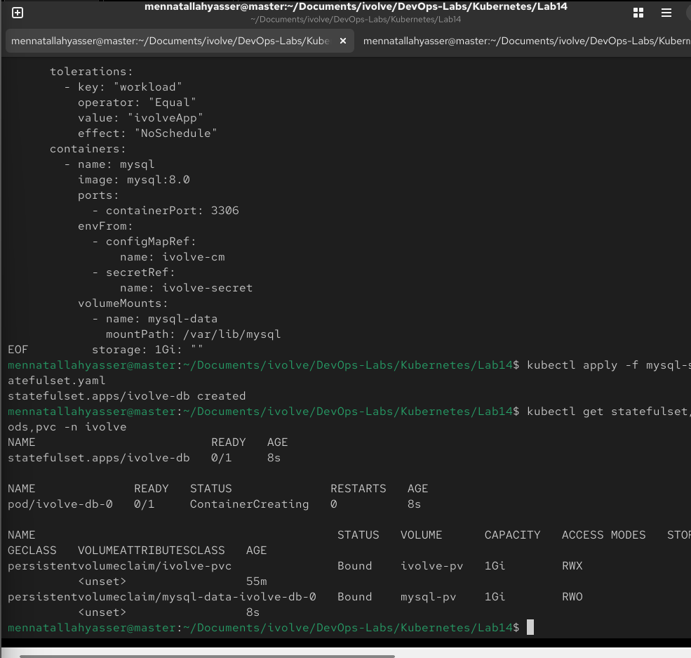
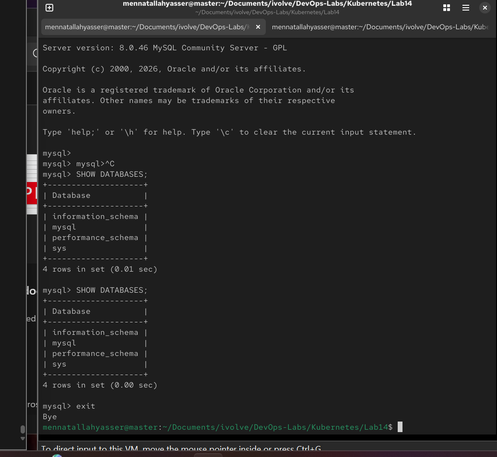
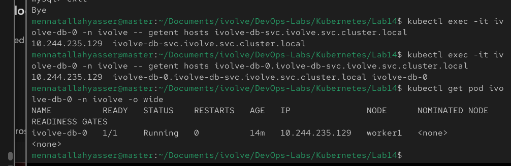
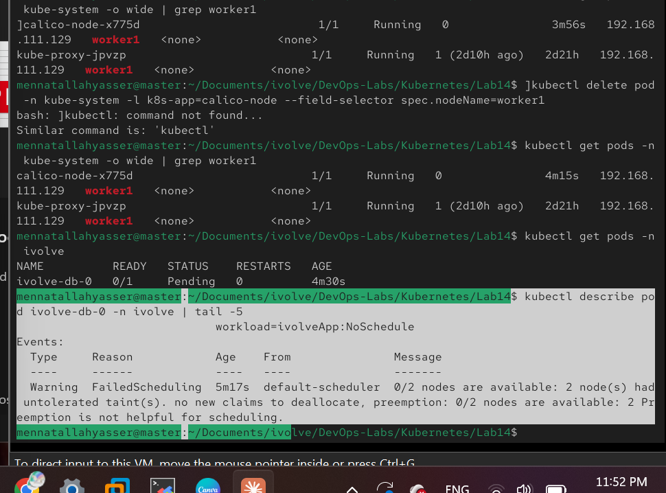
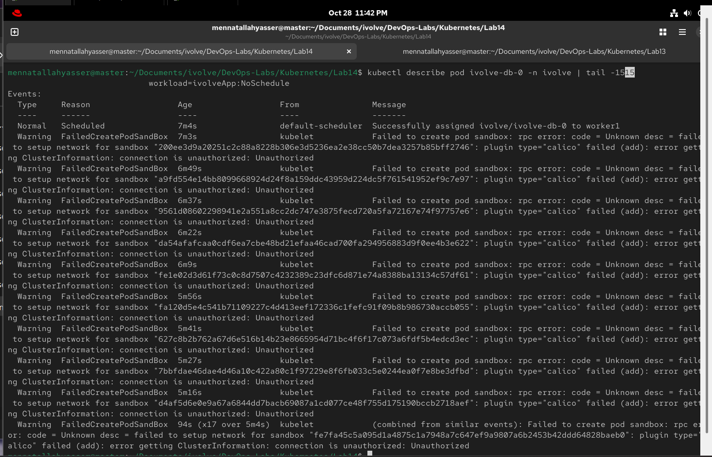

# Lab 14: StatefulSet with Headless Service

Run MySQL in the `ivolve` namespace as a StatefulSet, using the pieces from the previous labs:

| From | Used for |
|---|---|
| Lab 10 | `nodeSelector` (`project=ivolve`) and toleration (`workload=ivolveApp:NoSchedule`) to run on `worker1` |
| Lab 11 | The pod fits in the `ivolve` quota (max 3 pods) |
| Lab 12 | Environment variables from `ivolve-cm` and `ivolve-secret` |
| Lab 13 | Persistent storage idea: a PVC template bound to a hostPath PV |

> The lab names them `ivolveDB` and `ivolveDBSvc`, but Kubernetes object names must be lowercase, so they are named `ivolve-db` and `ivolve-db-svc`.

## 1. Free the quota

The Lab 11 test pods use all 3 places in the quota, so they are deleted first:

```bash
kubectl delete pod pod1 pod2 pod3 -n ivolve
```

## 2. Create a PV for the MySQL data

There is no StorageClass, so the PVC template needs a PV to bind to (`ivolve-pv` is already used by the app logs). On `worker1`:

```bash
sudo mkdir -p /mnt/mysql-data
```

[mysql-pv.yaml](mysql-pv.yaml):

```yaml
apiVersion: v1
kind: PersistentVolume
metadata:
  name: mysql-pv
spec:
  capacity:
    storage: 1Gi
  accessModes:
    - ReadWriteOnce
  persistentVolumeReclaimPolicy: Retain
  storageClassName: ""
  hostPath:
    path: /mnt/mysql-data
```

```bash
kubectl apply -f mysql-pv.yaml
```

## 3. Create the headless Service

[mysql-svc.yaml](mysql-svc.yaml):

```yaml
apiVersion: v1
kind: Service
metadata:
  name: ivolve-db-svc
  namespace: ivolve
spec:
  clusterIP: None
  selector:
    app: ivolve-db
  ports:
    - port: 3306
      targetPort: 3306
```

`clusterIP: None` makes it headless: there is no shared IP, and DNS points directly to each pod with a stable name (`ivolve-db-0.ivolve-db-svc.ivolve.svc.cluster.local`).

```bash
kubectl apply -f mysql-svc.yaml
kubectl get svc -n ivolve
```

## 4. Point DB_HOST at the Service

`DB_HOST` in the Lab 12 ConfigMap is updated to the headless Service name:

```bash
sed -i 's/DB_HOST: .*/DB_HOST: ivolve-db-svc.ivolve.svc.cluster.local/' ../Lab12/configmap.yaml
kubectl apply -f ../Lab12/configmap.yaml
kubectl get configmap ivolve-cm -n ivolve -o yaml
```



## 5. Create the StatefulSet

[mysql-statefulset.yaml](mysql-statefulset.yaml):

```yaml
apiVersion: apps/v1
kind: StatefulSet
metadata:
  name: ivolve-db
  namespace: ivolve
spec:
  serviceName: ivolve-db-svc
  replicas: 1
  selector:
    matchLabels:
      app: ivolve-db
  template:
    metadata:
      labels:
        app: ivolve-db
    spec:
      nodeSelector:
        project: ivolve
      tolerations:
        - key: "workload"
          operator: "Equal"
          value: "ivolveApp"
          effect: "NoSchedule"
      containers:
        - name: mysql
          image: mysql:8.0
          ports:
            - containerPort: 3306
          envFrom:
            - configMapRef:
                name: ivolve-cm
            - secretRef:
                name: ivolve-secret
          volumeMounts:
            - name: mysql-data
              mountPath: /var/lib/mysql
  volumeClaimTemplates:
    - metadata:
        name: mysql-data
      spec:
        accessModes:
          - ReadWriteOnce
        storageClassName: ""
        resources:
          requests:
            storage: 1Gi
```

- `serviceName` links the pods to the headless Service for their DNS names
- `envFrom` loads all keys from the ConfigMap and the Secret; MySQL uses `MYSQL_ROOT_PASSWORD` as the root password
- `volumeClaimTemplates` creates the PVC `mysql-data-ivolve-db-0`, which binds to `mysql-pv`

```bash
kubectl apply -f mysql-statefulset.yaml
kubectl get statefulset,pods,pvc -n ivolve
```



## 6. Connect with a MySQL client

The root password is read from the Secret inside the pod:

```bash
kubectl exec -it ivolve-db-0 -n ivolve -- sh -c 'mysql -u root -p"$MYSQL_ROOT_PASSWORD"'
```

```sql
SHOW DATABASES;
exit
```



## 7. Verify DNS resolution

```bash
kubectl exec -it ivolve-db-0 -n ivolve -- getent hosts ivolve-db-svc.ivolve.svc.cluster.local
kubectl exec -it ivolve-db-0 -n ivolve -- getent hosts ivolve-db-0.ivolve-db-svc.ivolve.svc.cluster.local
kubectl get pod ivolve-db-0 -n ivolve -o wide
```

Both names resolve to the pod IP, and the pod runs on `worker1`:



## Troubleshooting

### Pod `Pending`: disk-pressure taint

`worker1` was almost full (96%), so Kubernetes added the `node.kubernetes.io/disk-pressure:NoSchedule` taint and the pod could not be scheduled:



On `worker1`, space was freed:

```bash
rm -rf ~/.cache/*
sudo crictl rmi --prune
sudo dnf clean all
sudo journalctl --vacuum-size=50M
```

The free space was still close to the kubelet's default eviction limit (15% for images), so for this lab cluster the limit was lowered in `/var/lib/kubelet/config.yaml`:

```bash
sudo tee -a /var/lib/kubelet/config.yaml <<EOF
evictionHard:
  memory.available: "100Mi"
  nodefs.available: "5%"
  nodefs.inodesFree: "5%"
  imagefs.available: "5%"
EOF
sudo systemctl restart kubelet
```

The proper fix is a bigger disk for `worker1`.

### Pod stuck in `ContainerCreating`: Calico `Unauthorized`

```
plugin type="calico" failed (add): error getting ClusterInformation: connection is unauthorized: Unauthorized
```



The `calico-node` pod on `worker1` refreshes the token the Calico CNI plugin uses. It had stopped during the disk-pressure problem, so the token expired. Restarting it writes a new token:

```bash
kubectl delete pod -n kube-system -l k8s-app=calico-node --field-selector spec.nodeName=worker1
kubectl get pods -n kube-system -o wide | grep worker1
```
