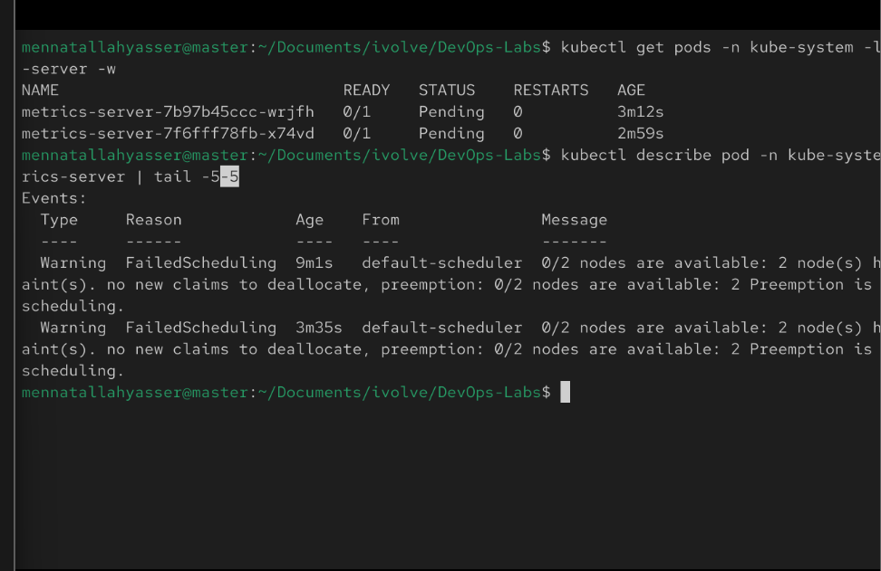
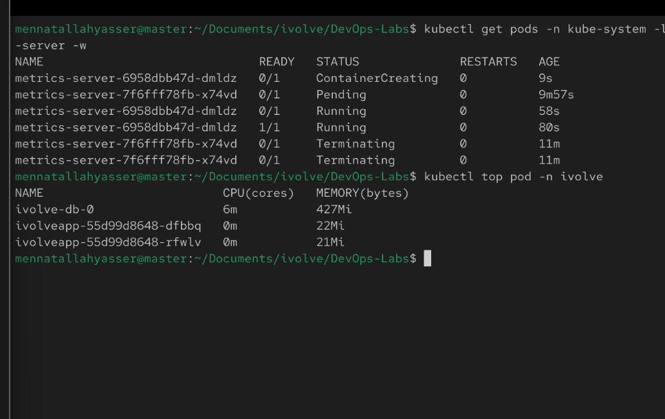

# Lab 16: Pod Resource Management with CPU and Memory Requests and Limits

Add resource requests and limits to the `ivolveapp` Deployment from Lab 15.

- **Requests**: what the scheduler reserves for the container on the node (`cpu: 1`, `memory: 1Gi`)
- **Limits**: the most the container may use (`cpu: 2`, `memory: 2Gi`)

## 1. Update the Deployment

[deployment.yaml](deployment.yaml) is the Lab 15 Deployment with a `resources` block on the app container:

```yaml
resources:
  requests:
    cpu: "1"
    memory: 1Gi
  limits:
    cpu: "2"
    memory: 2Gi
```

The same change as one command:

```bash
kubectl set resources deployment ivolveapp -n ivolve -c ivolveapp --requests=cpu=1,memory=1Gi --limits=cpu=2,memory=2Gi
kubectl rollout status deployment/ivolveapp -n ivolve
```

## 2. Verify the requests and limits

```bash
kubectl describe pod -n ivolve -l app=ivolveApp | grep -A6 -E "Limits|Requests"
```

## 3. Install metrics-server

`kubectl top` needs metrics-server:

```bash
kubectl apply -f https://github.com/kubernetes-sigs/metrics-server/releases/download/v0.7.2/components.yaml
kubectl patch deployment metrics-server -n kube-system --type=json -p='[{"op":"add","path":"/spec/template/spec/containers/0/args/-","value":"--kubelet-insecure-tls"}]'
```

- `--kubelet-insecure-tls`: kubeadm kubelets use self-signed certificates, which metrics-server rejects by default

### Problem: metrics-server stuck in Pending

The scheduler reported `0/2 nodes are available: 2 node(s) had untolerated taint(s)`. The master has the control-plane taint and `worker1` has `workload=ivolveApp:NoSchedule` (Lab 10), so metrics-server had nowhere to run.



Fix: give metrics-server the same toleration as the app:

```bash
kubectl patch deployment metrics-server -n kube-system --type=json -p='[{"op":"add","path":"/spec/template/spec/tolerations","value":[{"key":"workload","operator":"Equal","value":"ivolveApp","effect":"NoSchedule"}]}]'
```

## 4. Monitor resource usage

```bash
kubectl top pod -n ivolve
```


