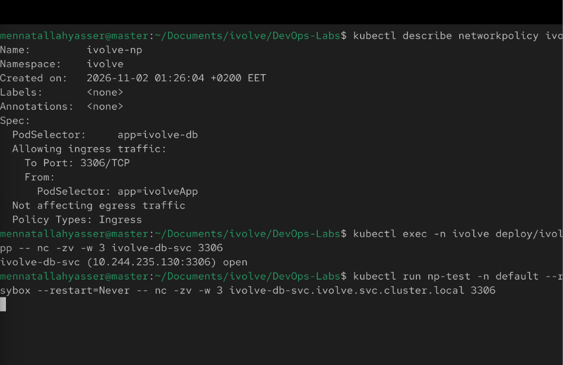
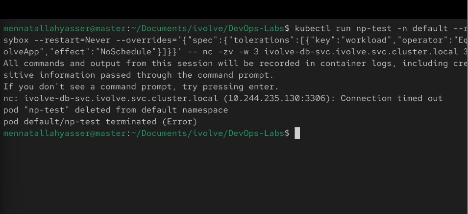

# Lab 17: Control Pod-to-Pod Traffic via Network Policy

Allow only the application pods to reach MySQL, and only on port 3306.

> The lab names it `ivolveNP`, but Kubernetes object names must be lowercase, so it is named `ivolve-np`.

The cluster uses Calico (Lab 9), which enforces NetworkPolicies.

## 1. Create the NetworkPolicy

[network-policy.yaml](network-policy.yaml):

```yaml
apiVersion: networking.k8s.io/v1
kind: NetworkPolicy
metadata:
  name: ivolve-np
  namespace: ivolve
spec:
  podSelector:
    matchLabels:
      app: ivolve-db
  policyTypes:
    - Ingress
  ingress:
    - from:
        - podSelector:
            matchLabels:
              app: ivolveApp
      ports:
        - protocol: TCP
          port: 3306
```

- `podSelector: app=ivolve-db`: the policy applies to the MySQL pod (Lab 14)
- `policyTypes: Ingress`: only incoming traffic is controlled
- `from: app=ivolveApp`: only the application pods (Lab 15) are allowed
- `port: 3306`: only on the MySQL port

```bash
kubectl apply -f network-policy.yaml
kubectl describe networkpolicy ivolve-np -n ivolve
```

## 2. Test: an application pod can connect

```bash
kubectl exec -n ivolve deploy/ivolveapp -c ivolveapp -- nc -zv -w 3 ivolve-db-svc 3306
```

The connection is `open`:



## 3. Test: any other pod is blocked

The test pod runs in `default` because the Lab 11 quota allows only 3 pods in `ivolve`. Both nodes are tainted, so it needs the `workload=ivolveApp` toleration to be scheduled:

```bash
kubectl run np-test -n default --rm -it --image=busybox --restart=Never --overrides='{"spec":{"tolerations":[{"key":"workload","operator":"Equal","value":"ivolveApp","effect":"NoSchedule"}]}}' -- nc -zv -w 3 ivolve-db-svc.ivolve.svc.cluster.local 3306
```

The connection times out:


