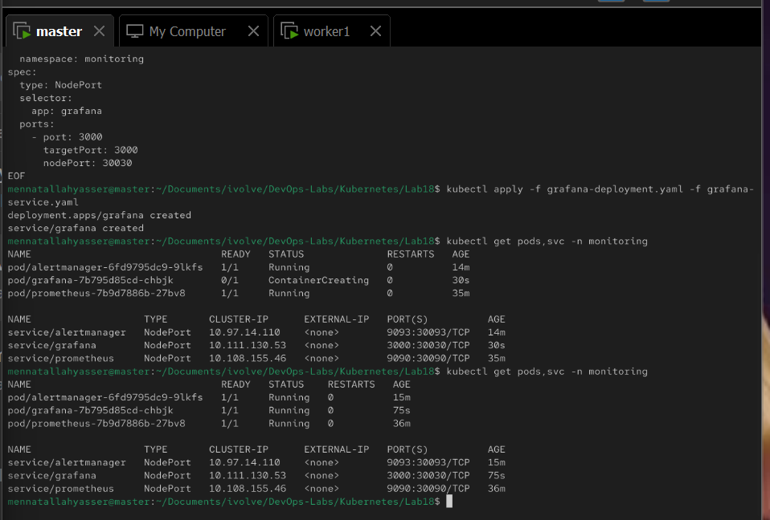
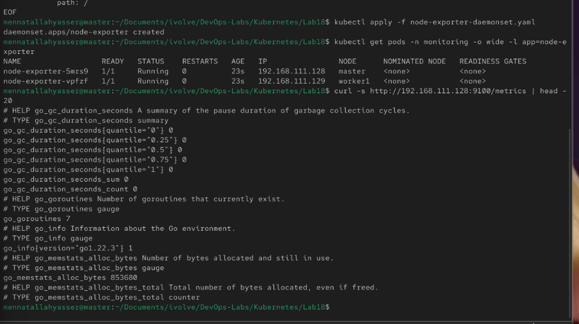
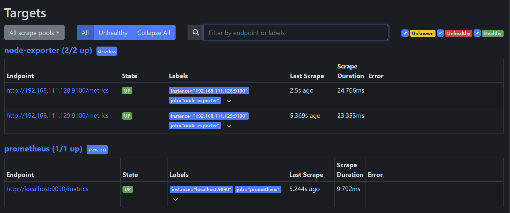
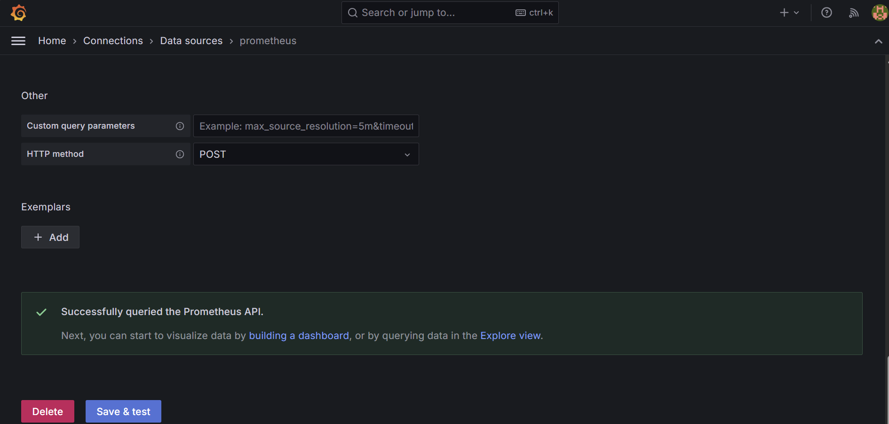
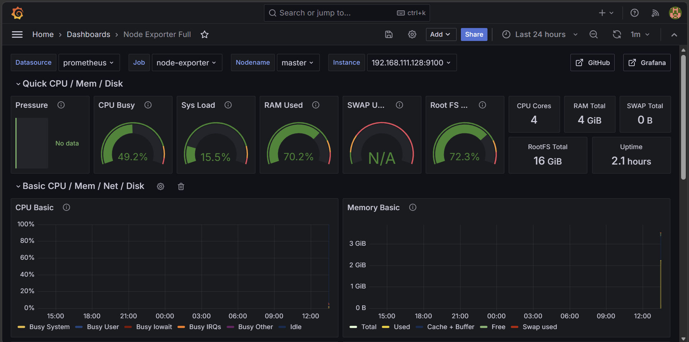

# Lab 18: Node-Wide Pod Management with DaemonSet

Deploy a monitoring stack (Prometheus, Alertmanager, Grafana) in the `monitoring` namespace, and run Prometheus node-exporter on every node with a DaemonSet.

```
 master (.128)                 worker1 (.129)
[node-exporter :9100]         [node-exporter :9100]    <- DaemonSet: one pod per node
         \                           /
          v                         v
          [ Prometheus :30090 ]  scrapes every 15s
             |              |
             v              v
  [ Grafana :30030 ]   [ Alertmanager :30093 ]
```

> The `workload=ivolveApp:NoSchedule` taint from Lab 10 was removed from `worker1` (`kubectl taint nodes worker1 workload=ivolveApp:NoSchedule-`); otherwise the Prometheus pod stayed `Pending` because both nodes were tainted.

## 1. Create the monitoring namespace

[namespace.yaml](namespace.yaml):

```bash
kubectl apply -f namespace.yaml
```

## 2. Deploy Prometheus

- [prometheus-config.yaml](prometheus-config.yaml): ConfigMap holding `prometheus.yml`, mounted at `/etc/prometheus`
- [prometheus-deployment.yaml](prometheus-deployment.yaml): `prom/prometheus:v2.53.0`, port 9090
- [prometheus-service.yaml](prometheus-service.yaml): NodePort `30090`

```bash
kubectl apply -f prometheus-config.yaml -f prometheus-deployment.yaml -f prometheus-service.yaml
```

## 3. Deploy Alertmanager

- [alertmanager-config.yaml](alertmanager-config.yaml): minimal config with one `default` receiver
- [alertmanager-deployment.yaml](alertmanager-deployment.yaml): `prom/alertmanager:v0.27.0`, port 9093
- [alertmanager-service.yaml](alertmanager-service.yaml): NodePort `30093`

```bash
kubectl apply -f alertmanager-config.yaml -f alertmanager-deployment.yaml -f alertmanager-service.yaml
```

## 4. Deploy Grafana

- [grafana-deployment.yaml](grafana-deployment.yaml): `grafana/grafana:11.1.0`, port 3000 (default login `admin` / `admin`)
- [grafana-service.yaml](grafana-service.yaml): NodePort `30030`

```bash
kubectl apply -f grafana-deployment.yaml -f grafana-service.yaml
kubectl get pods,svc -n monitoring
```



## 5. Deploy node-exporter as a DaemonSet

[node-exporter-daemonset.yaml](node-exporter-daemonset.yaml):

```yaml
apiVersion: apps/v1
kind: DaemonSet
metadata:
  name: node-exporter
  namespace: monitoring
spec:
  selector:
    matchLabels:
      app: node-exporter
  template:
    metadata:
      labels:
        app: node-exporter
    spec:
      hostNetwork: true
      hostPID: true
      tolerations:
        - operator: Exists
      containers:
        - name: node-exporter
          image: prom/node-exporter:v1.8.1
          args:
            - --path.rootfs=/host
          ports:
            - containerPort: 9100
          volumeMounts:
            - name: rootfs
              mountPath: /host
              readOnly: true
      volumes:
        - name: rootfs
          hostPath:
            path: /
```

- `kind: DaemonSet`: one pod on every node, no `replicas`
- `hostNetwork: true`: the pod uses the node IP, so metrics are served on `<node_IP>:9100`
- `hostPID: true`: sees the node's processes
- `tolerations: operator: Exists`: tolerates every taint, so it also runs on the control-plane node
- `hostPath: /` mounted read-only at `/host`: reads the node's filesystem instead of the container's

```bash
kubectl apply -f node-exporter-daemonset.yaml
```

## 6. Validate one pod per node and the metrics endpoint

```bash
kubectl get pods -n monitoring -o wide -l app=node-exporter
curl -s http://192.168.111.128:9100/metrics | head -20
```

One pod runs on `master` and one on `worker1`, with the node IPs:



## 7. Configure Prometheus to scrape node-exporter

[prometheus-config.yaml](prometheus-config.yaml) adds the Alertmanager address and a `node-exporter` job with both nodes:

```yaml
    alerting:
      alertmanagers:
        - static_configs:
            - targets: ['alertmanager:9093']
    scrape_configs:
      - job_name: prometheus
        static_configs:
          - targets: ['localhost:9090']
      - job_name: node-exporter
        static_configs:
          - targets:
              - '192.168.111.128:9100'
              - '192.168.111.129:9100'
```

Prometheus reads its config only at startup, so restart it after updating the ConfigMap:

```bash
kubectl apply -f prometheus-config.yaml
kubectl rollout restart deployment prometheus -n monitoring
```

**Status → Targets** shows `node-exporter (2/2 up)`:



## 8. Configure the Grafana dashboard

1. **Connections → Data sources → Add data source → Prometheus**, URL `http://prometheus:9090`, then **Save & test**

   

2. **Dashboards → New → Import**, ID `1860` (Node Exporter Full), select the Prometheus data source

   
