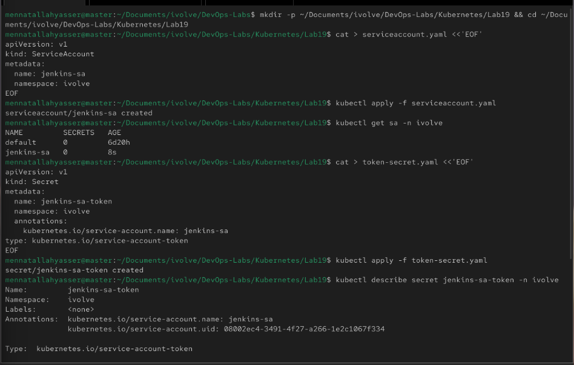
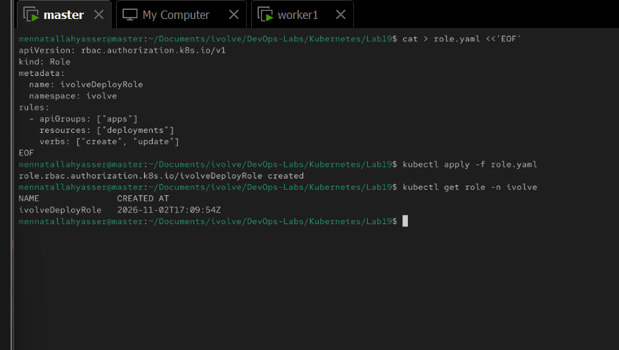
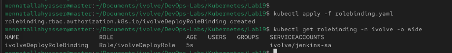
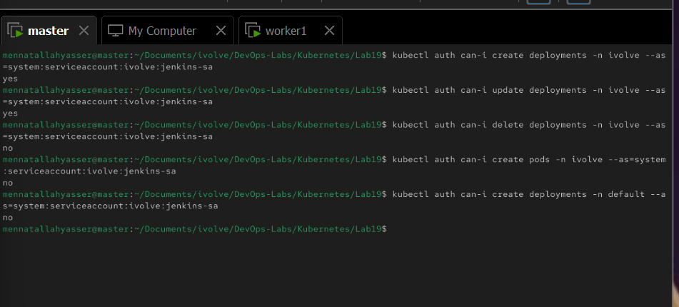

# Lab 19: Securing Kubernetes with RBAC and Service Accounts

Give Jenkins its own identity in the cluster, allowed to create and update Deployments in the `ivolve` namespace and nothing else.

```
jenkins-sa  ──(ivolveDeployRoleBinding)──►  ivolveDeployRole
  (who)                                     (what: create/update deployments in ivolve)
```

> The lab names it `jenkinsSA`, but ServiceAccount names must be lowercase, so it is named `jenkins-sa`. Role and RoleBinding names allow uppercase, so `ivolveDeployRole` and `ivolveDeployRoleBinding` are kept.

## 1. Create the ServiceAccount

[serviceaccount.yaml](serviceaccount.yaml):

```yaml
apiVersion: v1
kind: ServiceAccount
metadata:
  name: jenkins-sa
  namespace: ivolve
```

```bash
kubectl apply -f serviceaccount.yaml
kubectl get sa -n ivolve
```

## 2. Create a token for the ServiceAccount

[token-secret.yaml](token-secret.yaml):

```yaml
apiVersion: v1
kind: Secret
metadata:
  name: jenkins-sa-token
  namespace: ivolve
  annotations:
    kubernetes.io/service-account.name: jenkins-sa
type: kubernetes.io/service-account-token
```

- `type: kubernetes.io/service-account-token` with the `service-account.name` annotation: Kubernetes generates the token and stores it in the Secret
- The token does not expire, unlike `kubectl create token jenkins-sa -n ivolve` (1 hour by default)

```bash
kubectl apply -f token-secret.yaml
kubectl describe secret jenkins-sa-token -n ivolve
kubectl get secret jenkins-sa-token -n ivolve -o jsonpath='{.data.token}' | base64 -d
```



## 3. Create the Role

[role.yaml](role.yaml):

```yaml
apiVersion: rbac.authorization.k8s.io/v1
kind: Role
metadata:
  name: ivolveDeployRole
  namespace: ivolve
rules:
  - apiGroups: ["apps"]
    resources: ["deployments"]
    verbs: ["create", "update"]
```

- `Role` (not `ClusterRole`): only applies inside `ivolve`
- `apiGroups: ["apps"]`: Deployments are in the `apps` API group (`apiVersion: apps/v1`)
- `verbs: ["create", "update"]`: anything not listed (get, delete, ...) is denied

```bash
kubectl apply -f role.yaml
kubectl get role -n ivolve
```



## 4. Create the RoleBinding

[rolebinding.yaml](rolebinding.yaml):

```yaml
apiVersion: rbac.authorization.k8s.io/v1
kind: RoleBinding
metadata:
  name: ivolveDeployRoleBinding
  namespace: ivolve
subjects:
  - kind: ServiceAccount
    name: jenkins-sa
    namespace: ivolve
roleRef:
  kind: Role
  name: ivolveDeployRole
  apiGroup: rbac.authorization.k8s.io
```

- `subjects`: who gets the permissions (`jenkins-sa`)
- `roleRef`: which permissions (`ivolveDeployRole`)

```bash
kubectl apply -f rolebinding.yaml
kubectl get rolebinding -n ivolve -o wide
```



## 5. Validate the permissions

`kubectl auth can-i --as` checks a request as the ServiceAccount (`system:serviceaccount:<namespace>:<name>`):

```bash
kubectl auth can-i create deployments -n ivolve --as=system:serviceaccount:ivolve:jenkins-sa   # yes
kubectl auth can-i update deployments -n ivolve --as=system:serviceaccount:ivolve:jenkins-sa   # yes
kubectl auth can-i delete deployments -n ivolve --as=system:serviceaccount:ivolve:jenkins-sa   # no
kubectl auth can-i create pods -n ivolve --as=system:serviceaccount:ivolve:jenkins-sa          # no
kubectl auth can-i create deployments -n default --as=system:serviceaccount:ivolve:jenkins-sa  # no
```

Only create/update on Deployments in `ivolve` is allowed:


