# Lab 9: Deploy Kubernetes Cluster using Kubeadm

A 2-node Kubernetes cluster (1 control plane + 1 worker) built with kubeadm, containerd and Calico.

## Environment

| Node | Role | IP | OS |
|---|---|---|---|
| master | control-plane | 192.168.111.128 | Red Hat Enterprise Linux 10.1 |
| worker1 | worker | 192.168.111.129 | Red Hat Enterprise Linux 10.1 |

- VMware Workstation VMs: 4 GB RAM, 4 CPUs, 20 GB disk, NAT network
- Kubernetes v1.34.12, containerd 2.4.2, Calico CNI
- Pod network CIDR: `10.244.0.0/16` (Calico's default `192.168.0.0/16` overlaps the VM network `192.168.111.0/24`)

## 1. Prepare the node

Set the hostname:

```bash
sudo hostnamectl set-hostname master
```

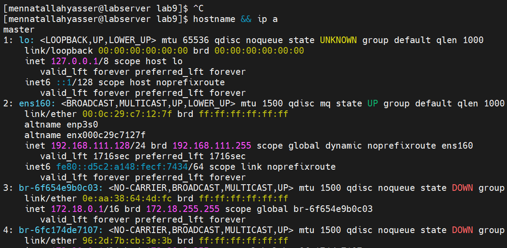

Add both nodes to `/etc/hosts`:

```bash
echo -e "192.168.111.128  master\n192.168.111.129  worker1" | sudo tee -a /etc/hosts
```

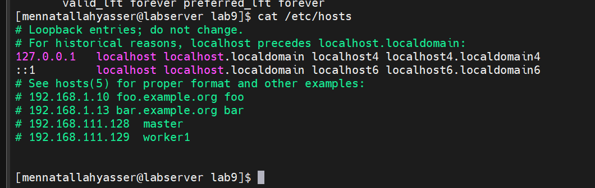

Disable swap, set SELinux to permissive and disable the firewall:

```bash
sudo swapoff -a
sudo sed -i '/ swap / s/^/#/' /etc/fstab
sudo setenforce 0
sudo sed -i 's/^SELINUX=enforcing/SELINUX=permissive/' /etc/selinux/config
sudo systemctl disable --now firewalld
```

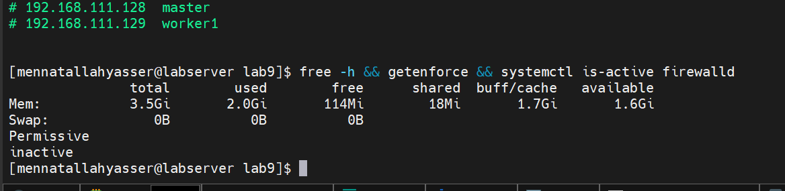

Load the kernel modules and enable the network settings Kubernetes needs:

```bash
cat <<EOF | sudo tee /etc/modules-load.d/k8s.conf
overlay
br_netfilter
EOF
sudo modprobe overlay
sudo modprobe br_netfilter

cat <<EOF | sudo tee /etc/sysctl.d/k8s.conf
net.bridge.bridge-nf-call-iptables  = 1
net.bridge.bridge-nf-call-ip6tables = 1
net.ipv4.ip_forward                 = 1
EOF
sudo sysctl --system
```

- `overlay`: lets containerd stack image layers
- `br_netfilter`: makes bridged pod traffic go through iptables

## 2. Install and configure containerd

```bash
sudo dnf config-manager --add-repo https://download.docker.com/linux/rhel/docker-ce.repo
sudo dnf install -y containerd.io
```

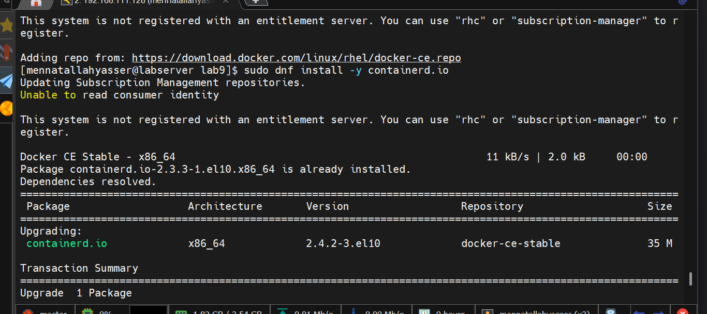

Generate the default config and switch to the systemd cgroup driver (must match kubelet):

```bash
sudo mkdir -p /etc/containerd
containerd config default | sudo tee /etc/containerd/config.toml
sudo sed -i 's/SystemdCgroup = false/SystemdCgroup = true/' /etc/containerd/config.toml
sudo systemctl restart containerd
sudo systemctl enable containerd
```

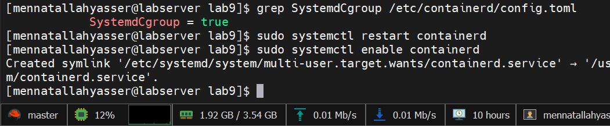

## 3. Install kubeadm, kubelet and kubectl

```bash
cat <<EOF | sudo tee /etc/yum.repos.d/kubernetes.repo
[kubernetes]
name=Kubernetes
baseurl=https://pkgs.k8s.io/core:/stable:/v1.34/rpm/
enabled=1
gpgcheck=1
gpgkey=https://pkgs.k8s.io/core:/stable:/v1.34/rpm/repodata/repomd.xml.key
exclude=kubelet kubeadm kubectl cri-tools kubernetes-cni
EOF

sudo dnf install -y kubelet kubeadm kubectl --disableexcludes=kubernetes
sudo dnf install -y cri-tools --disableexcludes=kubernetes
```

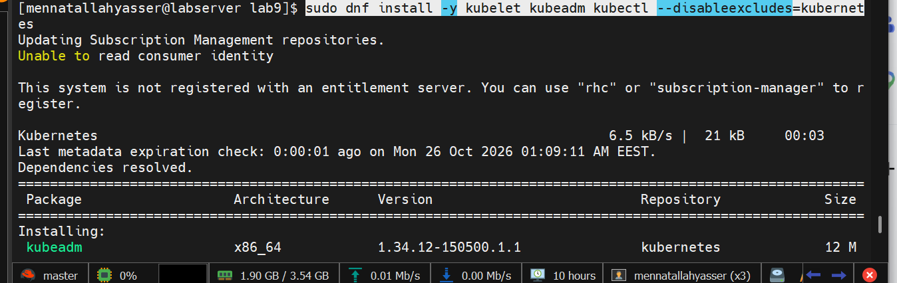

```bash
sudo systemctl enable --now kubelet
```

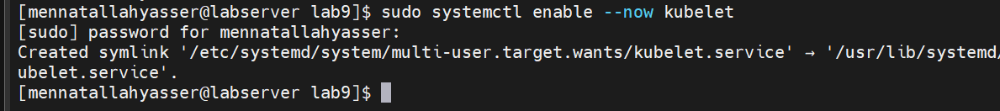

Pre-pull the control plane images:

```bash
sudo kubeadm config images pull
sudo crictl images
```

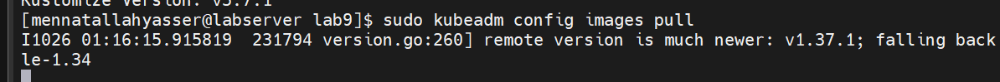

## 4. Create the worker node

`worker1` was created as a **full clone** of `master` (after step 3, before `kubeadm init`), so it already has containerd and the Kubernetes tools.

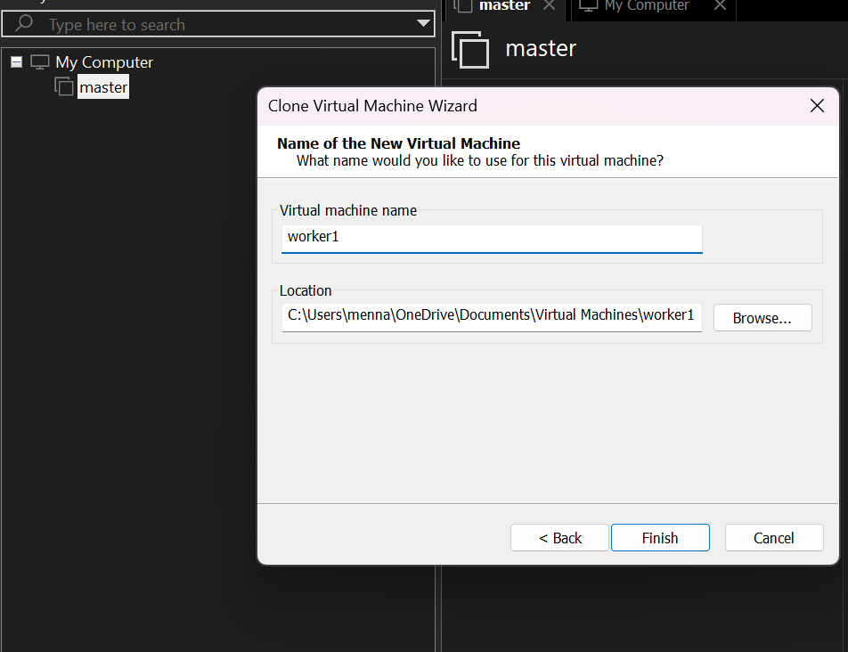

A new MAC address was generated so the clone gets its own IP:

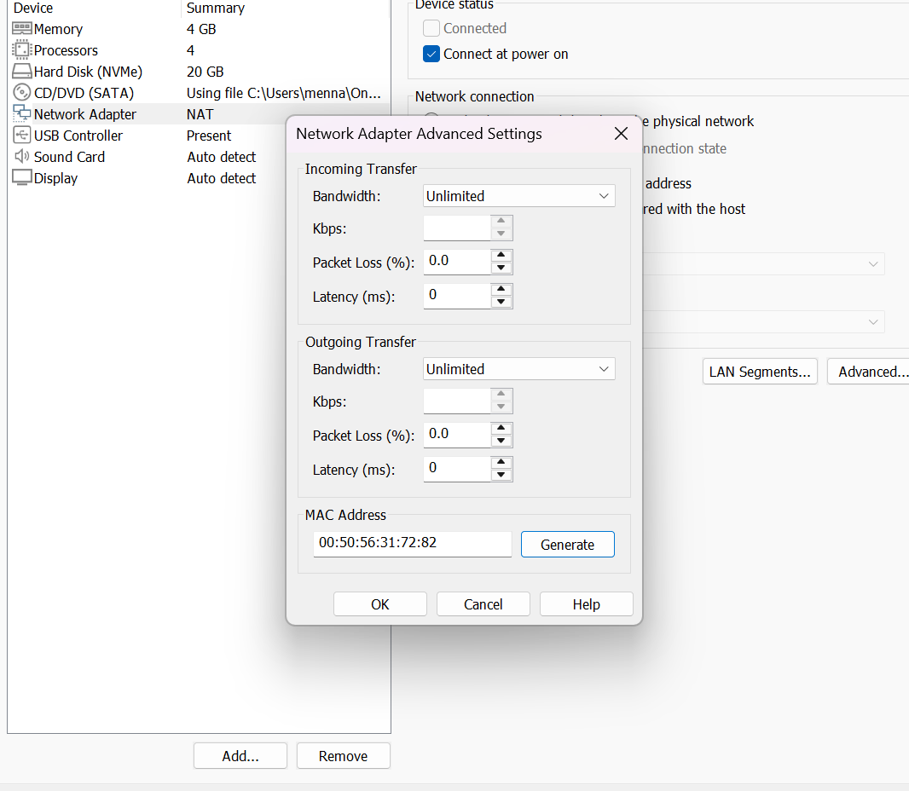

On `worker1`, set a new hostname and machine ID:

```bash
sudo hostnamectl set-hostname worker1
sudo rm -f /etc/machine-id
sudo systemd-machine-id-setup
```

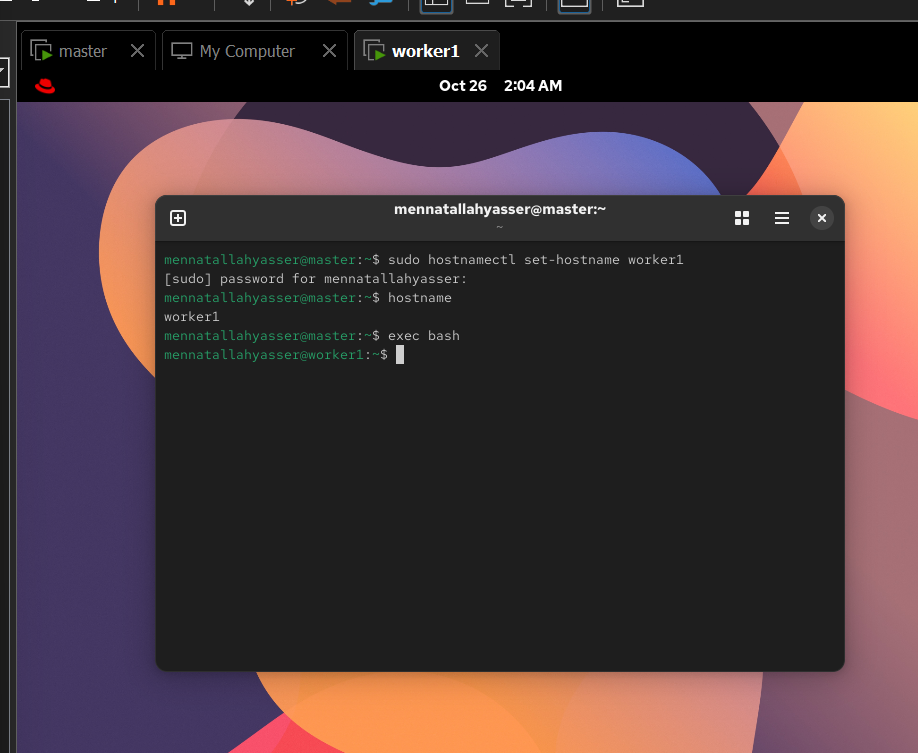

Set the IP and bring the connection up:

```bash
sudo nmcli connection modify my-ens160 802-3-ethernet.mac-address ""
sudo nmcli connection modify my-ens160 ipv4.addresses 192.168.111.129/24
sudo nmcli connection up my-ens160 ifname ens160
```

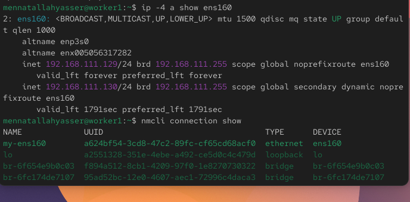

Add both nodes to `/etc/hosts` on master and worker1:

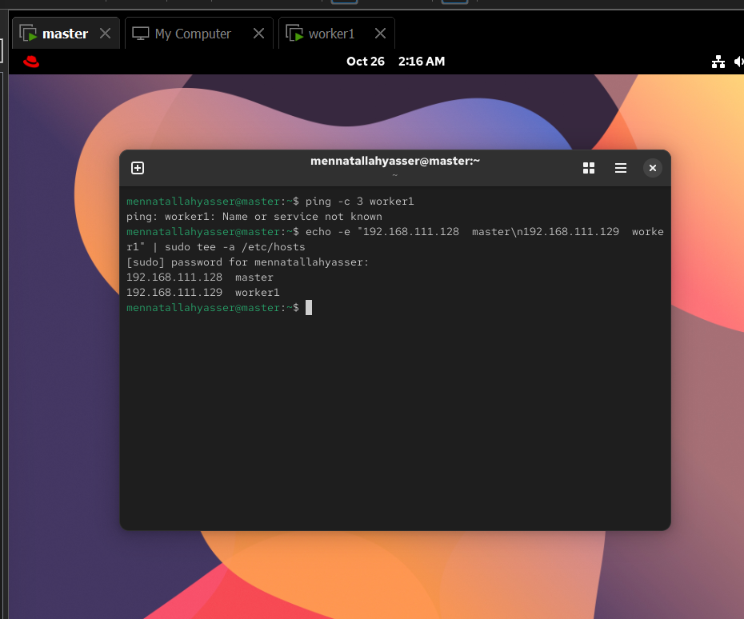

## 5. Initialize the control plane (master)

```bash
sudo kubeadm init --apiserver-advertise-address=192.168.111.128 --pod-network-cidr=10.244.0.0/16
```

## 6. Configure kubectl (master)

```bash
mkdir -p $HOME/.kube
sudo cp -i /etc/kubernetes/admin.conf $HOME/.kube/config
sudo chown $(id -u):$(id -g) $HOME/.kube/config
```

## 7. Install the Calico CNI plugin (master)

```bash
kubectl apply -f https://raw.githubusercontent.com/projectcalico/calico/v3.30.3/manifests/calico.yaml
kubectl get pods -n kube-system -w
```

Calico detects the pod CIDR (`10.244.0.0/16`) from the kubeadm configuration.

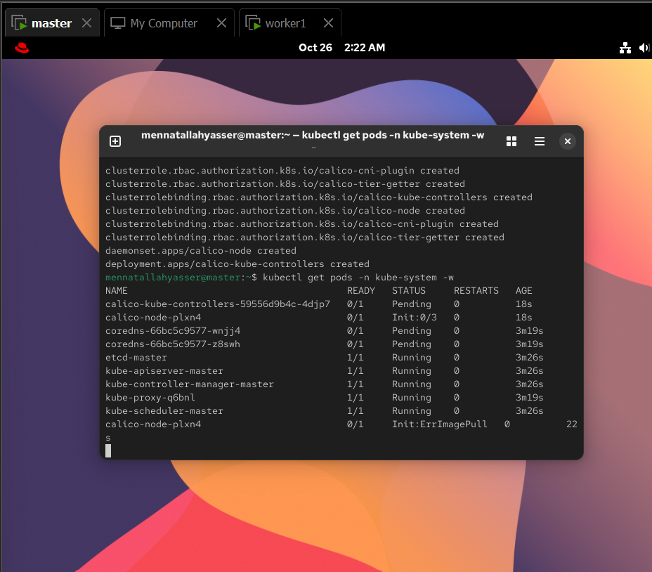

## 8. Join the worker node (worker1)

Run the join command printed by `kubeadm init`:

```bash
sudo kubeadm join 192.168.111.128:6443 --token <token> --discovery-token-ca-cert-hash sha256:<hash>
```

If the token has expired, create a new join command on master:

```bash
kubeadm token create --print-join-command
```

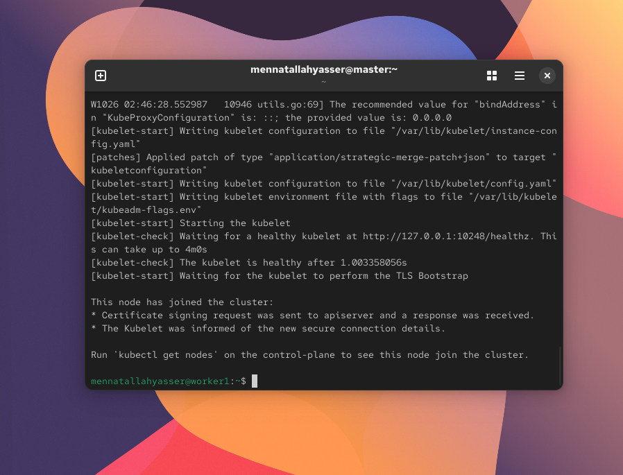

## 9. Verify the cluster

All system pods are running (Calico, CoreDNS, kube-proxy and the control plane):

```bash
kubectl get pods -n kube-system
```

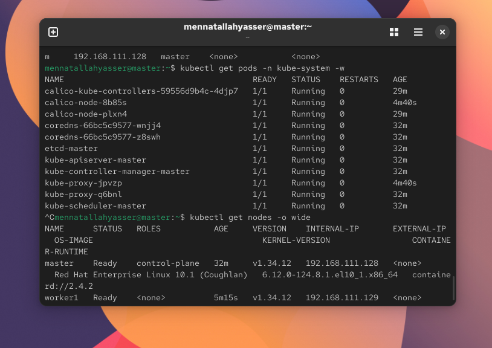

Both nodes are `Ready`:

```bash
kubectl get nodes -o wide
```

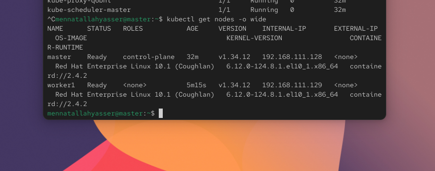

The control plane is healthy:

```bash
kubectl cluster-info
kubectl get --raw='/readyz?verbose'
```

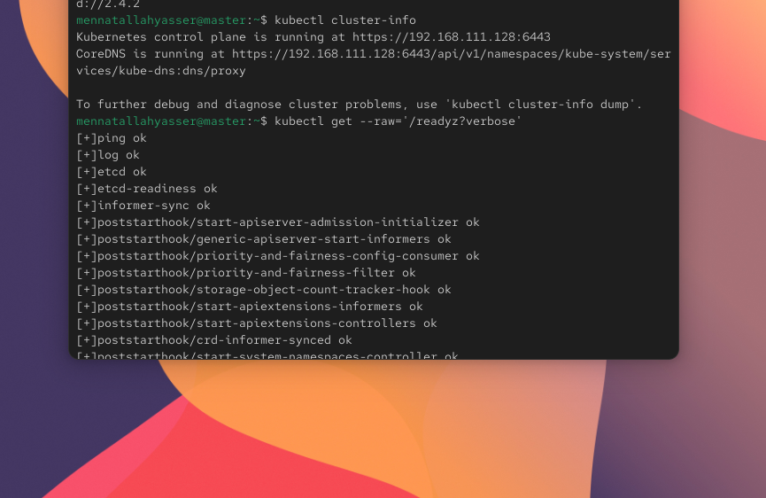
